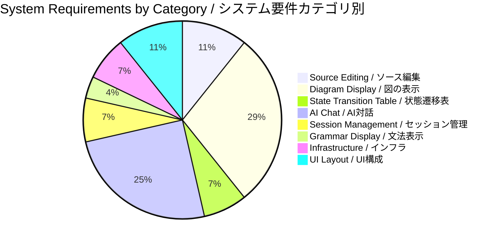

# ModelLogue Requirements Traceability / 要件トレーサビリティ

## 1. Functional Hierarchy Diagram / 機能系統図

```mermaid
flowchart LR
    subgraph UR["User Requirements / ユーザー要求"]
        UR001["UR-001<br/>Review state machine diagram<br/>状態遷移図をレビューする"]
        UR002["UR-002<br/>Edit PlantUML source<br/>PlantUMLソースを編集する"]
        UR003["UR-003<br/>View state transition table<br/>状態遷移表を見る"]
        UR004["UR-004<br/>Place markers on the diagram<br/>図にマーカーを配置する"]
        UR005["UR-005<br/>Discuss the model with AI<br/>AIとモデルについて対話する"]
        UR006["UR-006<br/>Apply AI suggestions<br/>AIの提案を適用する"]
        UR007["UR-007<br/>Export review session<br/>レビューセッションをエクスポートする"]
        UR008["UR-008<br/>View PlantUML subset grammar<br/>PlantUMLサブセット文法を見る"]
        UR009["UR-009<br/>Receive an initial model<br/>初版モデルを受け取る"]
        UR010["UR-010<br/>Close session with outcome<br/>結末を付けて終了する"]
        UR011["UR-011<br/>Convert source ↔ table<br/>ソースと表を相互変換する<br/>(補助サービスとして実装<br/>ADR-010, ADR-011)"]
    end

    subgraph SE["Source Editing / ソース編集"]
        SR001["SR-001<br/>Render PlantUML editor<br/>PlantUMLエディタを表示する"]
        SR002["SR-002<br/>Parse PlantUML subset<br/>PlantUMLサブセットを解析する"]
        SR003["SR-003<br/>Serialize model to PlantUML<br/>モデルをPlantUMLに変換する"]
    end

    subgraph DD["Diagram Display / 図の表示"]
        SR010["SR-010<br/>Display SVG with pan/zoom<br/>SVGをパン・ズーム付きで表示する"]
        SR011["SR-011<br/>Extract SVG coordinates<br/>SVG座標を抽出する"]
        SR012["SR-012<br/>Provide marker tool selection<br/>マーカーツールを選択する"]
        SR013["SR-013<br/>Draw marker by drag<br/>ドラッグでマーカーを描画する"]
        SR014["SR-014<br/>Manage marker colors<br/>マーカー色を管理する"]
        SR015["SR-015<br/>Select/move/resize markers<br/>マーカーを選択・移動・リサイズする"]
        SR016["SR-016<br/>Delete marker<br/>マーカーを削除する"]
        SR017["SR-017<br/>Render marker overlay<br/>マーカーを描画する"]
    end

    subgraph ST["State Transition Table / 状態遷移表"]
        SR020["SR-020<br/>Generate State×Event matrix<br/>状態×イベント表を生成する"]
        SR021["SR-021<br/>Generate PreState×PostState matrix<br/>遷移前×遷移後表を生成する"]
    end

    subgraph AC["AI Chat / AI対話"]
        SR022["SR-022<br/>Provide marker context to AI<br/>マーカー情報をAIに渡す"]
        SR030["SR-030<br/>Send chat message via n8n<br/>n8n経由でメッセージを送信する"]
        SR031["SR-031<br/>Render chat message list<br/>チャット一覧を表示する"]
        SR032["SR-032<br/>Extract PlantUML from AI response<br/>AI応答からPlantUMLを抽出する"]
        SR033["SR-033<br/>Display source diff<br/>ソース差分を表示する"]
        SR034["SR-034<br/>Apply proposed modification<br/>提案された修正を適用する"]
        SR035["SR-035<br/>Undo source modification<br/>ソース修正を元に戻す"]
    end

    subgraph SM["Session Management / セッション管理"]
        SR040["SR-040<br/>Manage session state<br/>セッション状態を管理する"]
        SR041["SR-041<br/>Export session as JSON<br/>セッションをJSONで出力する"]
    end

    subgraph GD["Grammar Display / 文法表示"]
        SR050["SR-050<br/>Display PlantUML subset grammar<br/>PlantUMLサブセット文法を表示する"]
    end

    subgraph IN["Infrastructure / インフラ"]
        SR060["SR-060<br/>Check PlantUML Server health<br/>PlantUML Server稼働確認"]
        SR061["SR-061<br/>Check n8n connectivity<br/>n8n接続確認"]
    end

    subgraph UI["UI Layout / UI構成"]
        SR070["SR-070<br/>Render diagram as primary view<br/>図をプライマリビューとして表示する"]
        SR071["SR-071<br/>Render analysis panel with tabs<br/>タブ付き解析パネルを表示する"]
        SR072["SR-072<br/>Render chat panel<br/>チャットパネルを表示する"]
    end

    %% UR-001: Review state machine diagram
    UR001 --> SR002
    UR001 --> SR010
    UR001 --> SR011
    UR001 --> SR060
    UR001 --> SR070

    %% UR-002: Edit PlantUML source
    UR002 --> SR001
    UR002 --> SR002
    UR002 --> SR040
    UR002 --> SR071

    %% UR-003: View state transition table
    UR003 --> SR002
    UR003 --> SR020
    UR003 --> SR021
    UR003 --> SR071

    %% UR-004: Place markers on the diagram
    UR004 --> SR011
    UR004 --> SR012
    UR004 --> SR013
    UR004 --> SR014
    UR004 --> SR015
    UR004 --> SR016
    UR004 --> SR017
    UR004 --> SR022

    %% UR-005: Discuss the model with AI
    UR005 --> SR022
    UR005 --> SR030
    UR005 --> SR031
    UR005 --> SR040
    UR005 --> SR061
    UR005 --> SR072

    %% UR-006: Apply AI suggestions
    UR006 --> SR003
    UR006 --> SR032
    UR006 --> SR033
    UR006 --> SR034
    UR006 --> SR035
    UR006 --> SR072

    %% UR-007: Export review session
    UR007 --> SR040
    UR007 --> SR041

    %% UR-008: View PlantUML subset grammar
    UR008 --> SR050
    UR008 --> SR071

    %% UR-009: Receive an initial model into the review session
    UR009 --> SR001
    UR009 --> SR002

    %% UR-010: Close the review session with an outcome
    UR010 --> SR040
    UR010 --> SR041
```

## 2. Traceability Matrix / トレーサビリティマトリクス

| System Requirement / システム要件 | UR-001 | UR-002 | UR-003 | UR-004 | UR-005 | UR-006 | UR-007 | UR-008 | UR-009 | UR-010 | UR-011 |
|----------------------------------|:------:|:------:|:------:|:------:|:------:|:------:|:------:|:------:|:------:|:------:|:------:|
| **Source Editing / ソース編集** |
| SR-001 PlantUMLエディタを表示する |  | x |  |  |  |  |  |  | x |  |  |
| SR-002 PlantUMLサブセットを解析する | x | x | x |  |  |  |  |  | x |  |  |
| SR-003 モデルをPlantUMLに変換する |  |  |  |  |  | x |  |  |  |  |  |
| **Diagram Display / 図の表示** |
| SR-010 SVGをパン・ズーム付きで表示する | x |  |  |  |  |  |  |  |  |  |  |
| SR-011 SVG座標を抽出する | x |  |  | x |  |  |  |  |  |  |  |
| SR-012 マーカーツールを選択する |  |  |  | x |  |  |  |  |  |  |  |
| SR-013 ドラッグでマーカーを描画する |  |  |  | x |  |  |  |  |  |  |  |
| SR-014 マーカー色を管理する |  |  |  | x |  |  |  |  |  |  |  |
| SR-015 マーカーを選択・移動・リサイズする |  |  |  | x |  |  |  |  |  |  |  |
| SR-016 マーカーを削除する |  |  |  | x |  |  |  |  |  |  |  |
| SR-017 マーカーを描画する |  |  |  | x |  |  |  |  |  |  |  |
| **State Transition Table / 状態遷移表** |
| SR-020 状態×イベント表を生成する |  |  | x |  |  |  |  |  |  |  |  |
| SR-021 遷移前×遷移後表を生成する |  |  | x |  |  |  |  |  |  |  |  |
| **AI Chat / AI対話** |
| SR-022 マーカー情報をAIコンテキストに渡す |  |  |  | x | x |  |  |  |  |  |  |
| SR-030 n8n経由でメッセージを送信する |  |  |  |  | x |  |  |  |  |  |  |
| SR-031 チャット一覧を表示する |  |  |  |  | x |  |  |  |  |  |  |
| SR-032 AI応答からPlantUMLを抽出する |  |  |  |  |  | x |  |  |  |  |  |
| SR-033 ソース差分を表示する |  |  |  |  |  | x |  |  |  |  |  |
| SR-034 提案された修正を適用する |  |  |  |  |  | x |  |  |  |  |  |
| SR-035 ソース修正を元に戻す |  |  |  |  |  | x |  |  |  |  |  |
| **Session Management / セッション管理** |
| SR-040 セッション状態を管理する |  | x |  |  | x |  | x |  |  | x |  |
| SR-041 セッションをJSONで出力する |  |  |  |  |  |  | x |  |  | x |  |
| **Grammar Display / 文法表示** |
| SR-050 PlantUMLサブセット文法を表示する |  |  |  |  |  |  |  | x |  |  |  |
| **Infrastructure / インフラ** |
| SR-060 PlantUML Server稼働確認 | x |  |  |  |  |  |  |  |  |  |  |
| SR-061 n8n接続確認 |  |  |  |  | x |  |  |  |  |  |  |
| **UI Layout / UI構成** |
| SR-070 図をプライマリビューとして表示する | x |  |  |  |  |  |  |  |  |  |  |
| SR-071 タブ付き解析パネルを表示する |  | x | x |  |  |  |  | x |  |  |  |
| SR-072 チャットパネルを表示する |  |  |  |  | x | x |  |  |  |  |  |

> **UR-011 について**: 列がすべて空欄なのは、ModelLogue本体のSRではなく、同一リポジトリ内の補助サービス（ADR-010）として実装するため。Future Extensions として system_requirements.yaml の末尾に記載されている。

## 3. Category Breakdown / カテゴリ別内訳

## 4. Related Documents / 関連文書

- [User Requirements / ユーザー要求](./requirements/user_requirements.yaml)
- [System Requirements / システム要件](./requirements/system_requirements.yaml)
- [Non-Functional Requirements / 非機能要件](./requirements/nonfunctional_requirements.yaml)
- [Test Strategy / テスト戦略](./requirements/test_strategy.yaml)
- [Requirements Specification / 要求仕様書](./requirements/Requirements_Specification.md)
