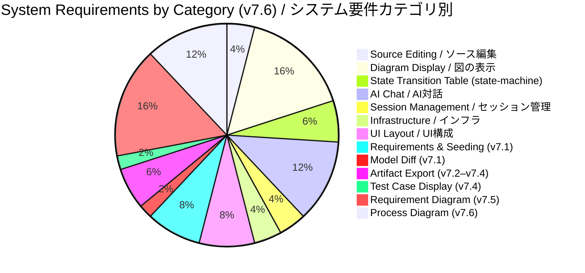

# ModelLogue Requirements Traceability / 要件トレーサビリティ

## 1. Functional Hierarchy Diagram / 機能系統図

```mermaid
flowchart LR
    subgraph UR["User Requirements / ユーザー要求"]
        UR001["UR-001<br/>Review state machine diagram<br/>状態遷移図をレビューする"]
        UR002["UR-002<br/>Edit PlantUML source<br/>PlantUMLソースを編集する"]
        UR003["UR-003<br/>View state transition table<br/>状態遷移表を見る"]
        UR004["UR-004<br/>Place markers on the diagram<br/>図にマーカーを配置する"]
        UR005["UR-005<br/>Discuss the model with AI<br/>AIとモデルについて対話する"]
        UR006["UR-006<br/>Apply AI suggestions<br/>AIの提案を適用する"]
        UR007["UR-007<br/>Export review session<br/>レビューセッションをエクスポートする"]
        UR008["UR-008<br/>Obtain PlantUML subset grammar (download)<br/>PlantUMLサブセット文法をDLする"]
        UR009["UR-009<br/>Receive initial model (+ optional requirements text)<br/>初版モデル（＋要求仕様断片）を受け取る"]
        UR010["UR-010<br/>Close session with outcome<br/>結末を付けて終了する"]
        UR011["UR-011<br/>Convert source ↔ table<br/>ソースと表を相互変換する<br/>(補助サービスとして実装<br/>ADR-010, ADR-011)"]
        UR012["UR-012<br/>Refer to requirements text<br/>要求仕様文を参照する"]
        UR013["UR-013<br/>Review N-switch test cases<br/>N-switchテストケースをレビューする<br/>(補助サービス tools/nswitch<br/>ADR-010)"]
        UR014["UR-014<br/>Review requirement diagram<br/>要求図をレビューする<br/>(ADR-012 モデル型プラグイン)"]
        UR015["UR-015<br/>Review process diagram<br/>業務プロセス図をレビューする<br/>(BPMN + Activity のゆるい共通部分)"]
        UR016["UR-016<br/>Establish the correct model type for the session<br/>型未指定／誤選択時にもセッションを正しいモデル型で確立する"]
    end

    subgraph SE["Source Editing / ソース編集"]
        SR001["SR-001 (v7.1)<br/>Source read-only reference<br/>(seed-editable when empty)<br/>ソースを読み取り専用で表示<br/>（空時のみ seed 編集可）"]
        SR002["SR-002<br/>Parse PlantUML subset<br/>PlantUMLサブセットを解析する"]
    end

    subgraph DD["Diagram Display / 図の表示"]
        SR010["SR-010<br/>Display SVG with pan/zoom<br/>SVGをパン・ズーム付きで表示する"]
        SR011["SR-011<br/>Extract SVG coordinates<br/>SVG座標を抽出する"]
        SR012["SR-012<br/>Provide marker tool selection<br/>マーカーツールを選択する"]
        SR013["SR-013<br/>Draw marker by drag<br/>ドラッグでマーカーを描画する"]
        SR014["SR-014<br/>Manage marker colors<br/>マーカー色を管理する"]
        SR015["SR-015<br/>Select/move/resize markers<br/>マーカーを選択・移動・リサイズする"]
        SR016["SR-016<br/>Delete marker<br/>マーカーを削除する"]
        SR017["SR-017<br/>Render marker overlay<br/>マーカーを描画する"]
    end

    subgraph ST["State Transition Table / 状態遷移表"]
        SR020["SR-020<br/>Generate State×Event matrix<br/>状態×イベント表を生成する"]
        SR021["SR-021<br/>Generate PreState×PostState matrix<br/>遷移前×遷移後表を生成する"]
    end

    subgraph AC["AI Chat / AI対話"]
        SR022["SR-022<br/>Provide marker + grammar context<br/>マーカー情報と文法をAIに渡す"]
        SR030["SR-030<br/>Send chat message via n8n<br/>n8n経由でメッセージを送信する"]
        SR031["SR-031<br/>Render chat message list<br/>チャット一覧を表示する"]
        SR032["SR-032<br/>Extract PlantUML from AI response<br/>AI応答からPlantUMLを抽出する"]
        SR033["SR-033 (v7.1 redefined)<br/>Visual before/after model comparison<br/>モデル図 before/after 並置 + 差分オーバーレイ"]
        SR034["SR-034<br/>Apply proposed modification<br/>提案された修正を適用する"]
        SR035["SR-035<br/>Undo source modification<br/>ソース修正を元に戻す"]
    end

    subgraph SM["Session Management / セッション管理"]
        SR040["SR-040<br/>Manage session state<br/>セッション状態を管理する"]
        SR041["SR-041<br/>Export session as JSON<br/>セッションをJSONで出力する"]
    end

    subgraph RT["Requirements & Seeding / 要求仕様＆シード (v7.1)"]
        SR080["SR-080<br/>Requirements tab (read-only during review)<br/>要求仕様タブ"]
        SR081["SR-081<br/>Download EBNF grammar file<br/>EBNFファイルをDL"]
        SR082["SR-082<br/>Generate initial model from requirements<br/>要求仕様から初版モデル生成"]
        SR083["SR-083<br/>Receive seed bundle from outside<br/>外部シードバンドル受け取り"]
    end

    subgraph MD["Model Diff / モデル差分 (v7.1)"]
        SR090["SR-090<br/>Compute model-level diff<br/>モデルレベル差分を計算"]
    end

    subgraph AE["Artifact Export / 個別エクスポート (v7.2–v7.3)"]
        SR100["SR-100<br/>Export PlantUML source (Copy / Save .puml)<br/>PlantUMLソースをコピー／保存"]
        SR101["SR-101<br/>Export canonical transition-table CSV (v7.3)<br/>正規状態遷移表CSVを出力"]
        SR102["SR-102<br/>Export generated test cases (Copy / Save)<br/>テストケースをコピー／保存 (v7.4)"]
    end

    subgraph TC["Test Case Display / テストケース表示 (v7.4)"]
        SR103["SR-103<br/>Display N-switch test cases reactively (v7.4)<br/>N-switchテストケースをリアクティブに表示する"]
    end

    subgraph RD["Requirement Diagram / 要求図 (v7.5)"]
        SR073["SR-073<br/>Select model type at seed (v7.5)<br/>セッションseed時にモデル型を選択"]
        SR110["SR-110<br/>Parse requirement-diagram input (v7.5)<br/>macro DSL + 半構造 seed 形を解析<br/>parser.ts + csvParser.ts"]
        SR111["SR-111<br/>Traceability matrix (v7.5)<br/>トレーサビリティマトリクスを生成<br/>traceability.ts + TraceabilityView"]
        SR112["SR-112<br/>Orphan requirements (v7.5)<br/>孤立要求を抽出する<br/>orphans.ts + OrphansView"]
        SR113["SR-113<br/>Requirement list table (v7.5)<br/>要求リスト表 + Copy/Save .csv + soft-delete UI<br/>RequirementListView + listSerializer.ts"]
        SR114["SR-114<br/>Renderer filter (v7.5 ADR-014)<br/>hidden を描画から除外<br/>renderer.ts"]
        SR115["SR-115<br/>Seed preamble in buffer (v7.5)<br/>!procedure preamble を buffer に同梱<br/>preamble.ts"]
        SR116["SR-116<br/>Apply CSV AI reply (v7.5)<br/>CSV→PlantUML regen + auto-apply + no modal<br/>extractSuggestedSource + csvParser + plantUmlGenerator"]
        SR117["SR-117<br/>Auto-markers on live diagram (v7.5)<br/>added=green / changed=amber<br/>diff.ts + svgCoordinates.ts + autoMarkerPlacement.ts"]
        SR118["SR-118<br/>level / group classification axes (v7.7, ADR-015)<br/>Requirement に level (user/system/design) と group を持たせる<br/>model.ts + csvParser.ts + listSerializer.ts"]
        SR119["SR-119<br/>Selectable visual grouping axis (v7.7, ADR-015)<br/>type / level / group のいずれかで package グルーピング<br/>plantUmlGenerator.ts"]
    end

    subgraph PD["Process Diagram / プロセス図 (v7.6)"]
        SR120["SR-120<br/>Scenarios tab — path enumeration (v7.6)<br/>start→end 全経路をテストケースとして列挙<br/>paths.ts + ScenariosView"]
        SR121["SR-121<br/>Events tab (v7.6)<br/>timer/message/error イベントを一覧化<br/>events.ts + EventsView"]
        SR122["SR-122<br/>Roles tab (v7.6)<br/>レーン別タスク + 引渡点を整理<br/>roles.ts + RolesView"]
        SR123["SR-123<br/>Artifacts tab (v7.6, 任意)<br/>矢印ラベル(伝票)のインベントリ<br/>artifacts.ts + ArtifactsView"]
        SR124["SR-124<br/>Parse process-diagram input (v7.6)<br/>PlantUML activity サブセットを解析<br/>parser.ts"]
        SR125["SR-125<br/>Externals tab (v7.6, 任意)<br/>note 内 **外部:** 注釈から外部 IT システムを抽出<br/>externals.ts + ExternalsView"]
    end

    subgraph PD2["Parser Diagnostics & Type Setup / パース診断・型セットアップ (v7.7)"]
        SR126["SR-126<br/>Cross-type parse diagnosis (v7.7)<br/>currentSource 入力時に他型 parser も試して提案<br/>crossTypeDiagnosis.ts + parseSuggestion + SourceEditor banner"]
        SR128["SR-128<br/>Source-preserving model-type switch (v7.7)<br/>currentSource / chat / markers を保ったまま型を切替<br/>sessionStore.setModelTypeIdKeepingSource"]
        SR129["SR-129<br/>Auto-detect on bundle without modelTypeId (v7.7)<br/>bundle に型が無いとき plantUmlSource から判定<br/>crossTypeDiagnosis.pickBestType + bootstrapFromBundle"]
        SR130["SR-130<br/>Apply-time review-evidence guardrail (v7.7, ADR-014 補強)<br/>AI csv reply で id が消えていたら apply 前に確認モーダル<br/>applyGuardrail.ts + ApplyGuardrailModal"]
    end

    subgraph IN["Infrastructure / インフラ"]
        SR060["SR-060<br/>Check PlantUML Server health<br/>PlantUML Server稼働確認"]
        SR061["SR-061<br/>Check n8n connectivity<br/>n8n接続確認"]
    end

    subgraph UI["UI Layout / UI構成"]
        SR070["SR-070<br/>Render diagram as primary view<br/>図をプライマリビューとして表示する"]
        SR071["SR-071<br/>Render analysis panel with tabs<br/>タブ付き解析パネルを表示する"]
        SR072["SR-072<br/>Render chat panel<br/>チャットパネルを表示する"]
    end

    %% UR-001: Review state machine diagram
    UR001 --> SR002
    UR001 --> SR010
    UR001 --> SR011
    UR001 --> SR060
    UR001 --> SR070

    %% UR-002: Refer to the PlantUML source of the current model
    UR002 --> SR001
    UR002 --> SR002
    UR002 --> SR040
    UR002 --> SR071

    %% UR-003: View state transition table
    UR003 --> SR002
    UR003 --> SR020
    UR003 --> SR021
    UR003 --> SR071

    %% UR-004: Place markers on the diagram
    UR004 --> SR011
    UR004 --> SR012
    UR004 --> SR013
    UR004 --> SR014
    UR004 --> SR015
    UR004 --> SR016
    UR004 --> SR017
    UR004 --> SR022

    %% UR-005: Discuss the model with AI
    UR005 --> SR022
    UR005 --> SR030
    UR005 --> SR031
    UR005 --> SR040
    UR005 --> SR061
    UR005 --> SR072

    %% UR-006: Apply AI suggestions (visual before/after model comparison)
    UR006 --> SR032
    UR006 --> SR033
    UR006 --> SR034
    UR006 --> SR035
    UR006 --> SR072
    UR006 --> SR090
    UR006 --> SR116
    UR006 --> SR117

    %% UR-007: Save review evidence + lift individual artifacts (v7.2)
    UR007 --> SR040
    UR007 --> SR041
    UR007 --> SR083
    UR007 --> SR100
    UR007 --> SR101

    %% UR-008: Grammar feeds the AI context and is downloadable
    UR008 --> SR022
    UR008 --> SR081

    %% UR-009: Receive initial model (+ optional requirements text) into the session
    UR009 --> SR001
    UR009 --> SR002
    UR009 --> SR080
    UR009 --> SR082
    UR009 --> SR083

    %% UR-016: Establish the correct model type for the session
    UR016 --> SR126
    UR016 --> SR128
    UR016 --> SR129
    UR016 --> SR130
    UR014 --> SR130

    %% UR-010: Close the review session with an outcome
    UR010 --> SR040
    UR010 --> SR041

    %% UR-012: Refer to requirements text alongside the model
    UR012 --> SR080
    UR012 --> SR071

    %% UR-013: Review N-switch test cases (v7.4)
    UR013 --> SR071
    UR013 --> SR103

    %% UR-014: Review requirement diagram (v7.5)
    UR014 --> SR073
    UR014 --> SR110
    UR014 --> SR111
    UR014 --> SR112
    UR014 --> SR113
    UR014 --> SR114
    UR014 --> SR115
    UR014 --> SR116
    UR014 --> SR117
    UR014 --> SR118
    UR014 --> SR119
    UR014 --> SR070
    UR014 --> SR071

    %% UR-004: Place markers on the diagram (v7.5: + auto-markers for requirement)
    UR004 --> SR117

    %% UR-015: Review process diagram (v7.6)
    UR015 --> SR073
    UR015 --> SR120
    UR015 --> SR121
    UR015 --> SR122
    UR015 --> SR123
    UR015 --> SR124
    UR015 --> SR125
    UR015 --> SR070
    UR015 --> SR071
    UR015 --> SR117
```

## 2. Traceability Matrix / トレーサビリティマトリクス

| System Requirement / システム要件 | UR-001 | UR-002 | UR-003 | UR-004 | UR-005 | UR-006 | UR-007 | UR-008 | UR-009 | UR-010 | UR-011 | UR-012 | UR-013 | UR-014 | UR-015 | UR-016 |
|----------------------------------|:------:|:------:|:------:|:------:|:------:|:------:|:------:|:------:|:------:|:------:|:------:|:------:|:------:|:------:|:------:|:------:|
| **Source Editing / ソース編集** |
| SR-001 ソースを読み取り専用で表示（seed時のみ編集可）|  | x |  |  |  |  |  |  | x |  |  |  |  | x | x |  |
| SR-002 PlantUMLサブセットを解析する (state-machine) | x | x | x |  |  |  |  |  | x |  |  |  |  |  |  |  |
| ~~SR-003~~ モデルをPlantUMLに変換する（**Removed**） |  |  |  |  |  | — |  |  |  |  |  |  |  |  |  |  |
| **Diagram Display / 図の表示** |
| SR-010 SVGをパン・ズーム付きで表示する | x |  |  |  |  |  |  |  |  |  |  |  |  | x | x |  |
| SR-011 SVG座標を抽出する | x |  |  | x |  |  |  |  |  |  |  |  |  | x | x |  |
| SR-012 マーカーツールを選択する（default=pan） |  |  |  | x |  |  |  |  |  |  |  |  |  |  |  |  |
| SR-013 ドラッグでマーカーを描画する |  |  |  | x |  |  |  |  |  |  |  |  |  |  |  |  |
| SR-014 マーカー色を管理する |  |  |  | x |  |  |  |  |  |  |  |  |  |  |  |  |
| SR-015 マーカーを選択・移動・リサイズする |  |  |  | x |  |  |  |  |  |  |  |  |  |  |  |  |
| SR-016 マーカーを削除する |  |  |  | x |  |  |  |  |  |  |  |  |  |  |  |  |
| SR-017 マーカーを描画する |  |  |  | x |  |  |  |  |  |  |  |  |  |  |  |  |
| **State Transition Table / 状態遷移表 (state-machine)** |
| SR-020 状態×イベント表を生成する (state-machine) |  |  | x |  |  |  |  |  |  |  |  |  |  |  |  |  |
| SR-021 遷移前×遷移後表を生成する (state-machine) |  |  | x |  |  |  |  |  |  |  |  |  |  |  |  |  |
| **AI Chat / AI対話** |
| SR-022 マーカー情報＋EBNFをAIコンテキストに渡す |  |  |  | x | x |  |  | x |  |  |  |  |  |  |  |  |
| SR-030 n8n経由でメッセージを送信する |  |  |  |  | x |  |  |  |  |  |  |  |  |  |  |  |
| SR-031 チャット一覧を表示する |  |  |  |  | x |  |  |  |  |  |  |  |  |  |  |  |
| SR-032 AI応答からPlantUMLを抽出する |  |  |  |  |  | x |  |  |  |  |  |  |  |  |  |  |
| SR-033 モデル before/after 並置 + 差分ハイライト (v7.1 redefined) |  |  |  |  |  | x |  |  |  |  |  |  |  |  |  |  |
| SR-034 提案された修正を適用する |  |  |  |  |  | x |  |  |  |  |  |  |  |  |  |  |
| SR-035 ソース修正を元に戻す |  |  |  |  |  | x |  |  |  |  |  |  |  |  |  |  |
| **Session Management / セッション管理** |
| SR-040 セッション状態を管理する |  | x |  |  | x |  | x |  |  | x |  |  |  |  |  |  |
| SR-041 セッションをJSONで出力する（requirementsText を含む） |  |  |  |  |  |  | x |  |  | x |  |  |  |  |  |  |
| **Grammar / 文法** |
| ~~SR-050~~ EBNFタブ（**Removed** in v7.1、SR-081 に置換）|  |  |  |  |  |  |  | — |  |  |  |  |  |  |  |  |
| **Infrastructure / インフラ** |
| SR-060 PlantUML Server稼働確認 | x |  |  |  |  |  |  |  |  |  |  |  |  | x | x |  |
| SR-061 n8n接続確認 |  |  |  |  | x |  |  |  |  |  |  |  |  |  |  |  |
| **UI Layout / UI構成** |
| SR-070 図をプライマリビューとして表示する | x |  |  |  |  |  |  |  |  |  |  |  |  | x | x |  |
| SR-071 タブ付き解析パネル（型固有タブセット、v7.5 ADR-012）|  | x | x |  |  |  |  |  |  |  |  | x | x | x | x |  |
| SR-072 チャットパネル + ProposalView |  |  |  |  | x | x |  |  |  |  |  |  |  |  |  |  |
| SR-073 セッションseed時にモデル型を選択 (v7.5) |  |  |  |  |  |  |  |  | x |  |  |  |  | x | x |  |
| **Requirements & Seeding / 要求仕様＆シード (v7.1)** |
| SR-080 要求仕様タブ（レビュー中は読み取り専用）|  |  |  |  |  |  |  |  | x |  |  | x |  |  |  |  |
| SR-081 EBNFファイルをダウンロード |  |  |  |  |  |  |  | x |  |  |  |  |  |  |  |  |
| SR-082 要求仕様から初版モデルを生成（チャット shortcut） |  |  |  |  |  |  |  |  | x |  |  |  |  |  |  |  |
| SR-083 外部シードバンドル `{requirementsText, plantUmlSource}` を受け取る |  |  |  |  |  |  |  |  | x |  |  |  |  |  |  |  |
| **Model Diff / モデル差分 (v7.1)** |
| SR-090 モデルレベル差分を計算（SR-033 が利用）|  |  |  |  |  | x |  |  |  |  |  |  |  |  |  |  |
| **Artifact Export / 個別エクスポート (v7.2–v7.3)** |
| SR-100 PlantUML ソース Copy / Save .puml |  |  |  |  |  |  | x |  |  |  |  |  |  |  |  |  |
| SR-101 状態遷移表を正規 CSV で出力 (v7.3, state-machine) |  |  |  |  |  |  | x |  |  |  |  |  |  |  |  |  |
| SR-102 テストケース Copy / Save (v7.4, state-machine) |  |  |  |  |  |  | x |  |  |  |  |  | x |  |  |  |
| **Test Case Display / テストケース表示 (v7.4, state-machine)** |
| SR-103 N-switch テストケースをリアクティブに表示 (v7.4, state-machine) |  |  |  |  |  |  |  |  |  |  |  |  | x |  |  |  |
| **Requirement Diagram / 要求図 (v7.5)** |
| SR-110 要求図入力（macro + 半構造）を解析 (v7.5) |  |  |  |  |  |  |  |  |  |  |  |  |  | x |  |  |
| SR-111 トレーサビリティマトリクスを生成 (v7.5) |  |  |  |  |  |  |  |  |  |  |  |  |  | x |  |  |
| SR-112 孤立要求を抽出 (v7.5) |  |  |  |  |  |  |  |  |  |  |  |  |  | x |  |  |
| SR-113 要求リスト表 + soft-delete UI + Copy/Save .csv (v7.5) |  |  |  |  |  |  |  |  |  |  |  |  |  | x |  |  |
| SR-114 Renderer filter: hidden/deleted を描画から除外 (v7.5) |  |  |  |  |  |  |  |  |  |  |  |  |  | x |  |  |
| SR-115 `!procedure` preamble を edit buffer に同梱 (v7.5) |  |  |  |  |  |  |  |  |  |  |  |  |  | x |  |  |
| SR-116 CSV AI 応答を apply（regen + auto-apply、モーダル無し） (v7.5) |  |  |  |  |  | x |  |  |  |  |  |  |  | x |  |  |
| SR-117 自動マーカー（added=緑 / changed=オレンジ） (v7.5) |  |  |  | x |  | x |  |  |  |  |  |  |  | x | x |  |
| SR-118 level / group 分類軸を要求モデルに追加 (v7.7, ADR-015) |  |  |  |  |  |  |  |  |  |  |  |  |  | x |  |  |
| SR-119 視覚的グルーピング軸の選択（type / level / group） (v7.7, ADR-015) |  |  |  |  |  |  |  |  |  |  |  |  |  | x |  |  |
| **Process Diagram / プロセス図 (v7.6)** |
| SR-120 Scenarios タブ (start→end 経路列挙) (v7.6) |  |  |  |  |  |  |  |  |  |  |  |  |  |  | x |  |
| SR-121 Events タブ (timer/message/error 一覧) (v7.6) |  |  |  |  |  |  |  |  |  |  |  |  |  |  | x |  |
| SR-122 Roles タブ (レーン別タスク + 引渡点) (v7.6) |  |  |  |  |  |  |  |  |  |  |  |  |  |  | x |  |
| SR-123 Artifacts タブ (矢印ラベル伝票インベントリ, 任意) (v7.6) |  |  |  |  |  |  |  |  |  |  |  |  |  |  | x |  |
| SR-124 プロセス図入力 (PlantUML activity サブセット) を解析 (v7.6) |  |  |  |  |  |  |  |  |  |  |  |  |  |  | x |  |
| SR-125 Externals タブ (note 内 **外部:** から外部 IT システム抽出, 任意) (v7.6) |  |  |  |  |  |  |  |  |  |  |  |  |  |  | x |  |
| **Parser Diagnostics / パース診断 (v7.7)** |
| SR-126 Cross-type parse diagnosis (v7.7) |  |  |  |  |  |  |  |  |  |  |  |  |  |  |  | x |
| SR-128 Source-preserving model-type switch (v7.7) |  |  |  |  |  |  |  |  |  |  |  |  |  |  |  | x |
| SR-129 Auto-detect on bundle without modelTypeId (v7.7) |  |  |  |  |  |  |  |  |  |  |  |  |  |  |  | x |
| SR-130 Apply-time review-evidence guardrail (v7.7, ADR-014 補強) |  |  |  |  |  |  |  |  |  |  |  |  |  | x |  | x |

> **UR-011 について**: 列がすべて空欄なのは、ModelLogue本体のSRではなく、同一リポジトリ内の補助サービス（ADR-010）として実装するため。Future Extensions として system_requirements.yaml の末尾に記載されている。

## 3. Category Breakdown / カテゴリ別内訳

> SR-003（Serialize model）は removed、SR-050（EBNF tab）も v7.1 で removed のため件数から除外。SR-050 の役割は SR-081（ダウンロード）に置き換えた。

## 4. Related Documents / 関連文書

- [User Requirements / ユーザー要求](./requirements/user_requirements.yaml)
- [System Requirements / システム要件](./requirements/system_requirements.yaml)
- [Non-Functional Requirements / 非機能要件](./requirements/nonfunctional_requirements.yaml)
- [Test Strategy / テスト戦略](./requirements/test_strategy.yaml)
- [Requirements Specification / 要求仕様書](./requirements/Requirements_Specification.md)
