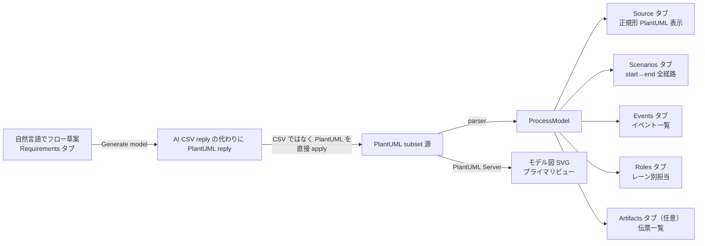
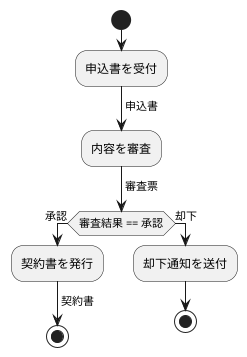
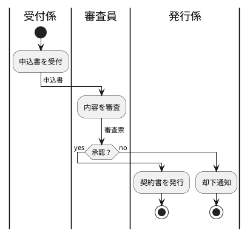

# ModelLogue Requirements Specification / ModelLogue 要求仕様書

| Item / 項目 | Content / 内容 |
|------|---------|
| Document / 文書 | ModelLogue Requirements Specification / ModelLogue 要求仕様書 |
| Version / バージョン | 7.2 (planned / 承認済・未実装) |
| Created / 作成日 | 2026-04-08 |
| Last Updated / 最終更新 | 2026-04-15 |
| Status / 状態 | v7.2 planned: lock-on-successful-parse, Undo+Redo on diagram toolbar, save-dialog contents checklist, empty-state guide, Open-saved-review accepts saved JSON, per-artifact Copy/Save (source as .puml, matrices as CSV/TSV), UI in plain English. v7.1 = implemented baseline. |

---

## 1. Purpose / 目的

This document defines requirements for ModelLogue, a model review platform for software development.

本文書は ModelLogue（ソフトウェア開発におけるモデルレビュー支援プラットフォーム）の要件を定義する。

**Current scope / 現在のスコープ**: State machine diagram review / 状態遷移図のレビュー

### 1.1 Documentation Structure / ドキュメント構成

| Type / 種別 | Location / 場所 | Purpose / 目的 |
|------|----------|---------|
| Data (YAML) / データ | [requirements/](.) | Machine-readable, single source of truth / 機械可読、唯一の真実源 |
| View (Markdown) / ビュー | This document / 本文書 | Human-readable summary / 可読性の高い要約 |
| Traceability / トレーサビリティ | [Traceability.md](../Traceability.md) | Hierarchy diagrams with Mermaid / Mermaid による系統図 |

### 1.2 Writing Conventions / 記述規約

| Level / レベル | Format / 形式 | Example / 例 |
|-------|--------|---------|
| User Requirement / ユーザー要件 | Task expression / タスク表現 | "Review the diagram" / "図をレビューする" |
| System Requirement / システム要件 | Verb + Object / 動詞＋目的語 | "Parse PlantUML source" / "PlantUMLソースを解析する" |
| Rule Scenario / ルールシナリオ | Context → Action → Outcome | See below / 下記参照 |

**Rule Scenario Structure / ルールシナリオ構造**:
```
状況:  ～の場合
操作:  ユーザーが～を行う
結果:  システムが～を返す
```

### 1.3 Core Concepts / コア・コンセプト

- **Volatile Canvas**: Model diagrams are temporary thinking canvases, not final deliverables / モデル図は一時的な思考のキャンバスであり最終成果物ではない
- **Dialogue as Asset**: Human-AI dialogue logs are treated as the essential design asset / 人間とAIの対話ログを設計の本質的な資産として扱う
- **Lean Architecture**: Orchestrate external services, don't own functionality / 機能を抱え込まず外部サービスをオーケストレーションする
- **Meaning from Source**: Diagram meaning comes from PlantUML source, not SVG / 図の意味はSVGではなくPlantUMLソースから得る
- **Marker-based Pointing**: Reviewers place colored markers (ellipse, rectangle, arrow) on top of the diagram to indicate "look here" during a review. Markers are not bound to a specific element; the AI uses the marker geometry plus the model element coordinates to figure out what is being pointed at. / レビューアは図の上に色付きマーカー（楕円・矩形・矢印）を置いて「ここに注目」を示す。マーカーは特定要素に縛られず、AIがマーカーの座標とモデル要素の座標から指示対象を推測する |

---

## 2. User Requirements / ユーザー要件

> Source / 出典: [user_requirements.yaml](./user_requirements.yaml)

| ID | Task / タスク | Priority / 優先度 |
|----|------|----------|
| UR-001 | Review state machine diagram / 状態遷移図をレビューする | High / 高 |
| UR-002 | Refer to the PlantUML source of the current model (read-only) / 現在のモデルのソースを参照する（読み取り専用） | High / 高 |
| UR-003 | View state transition table / 状態遷移表を見る | High / 高 |
| UR-004 | Place markers on the diagram / 図にマーカーを配置する | High / 高 |
| UR-005 | Discuss the model with AI / AIとモデルについて対話する | High / 高 |
| UR-006 | Apply AI suggestions (judged via visual before/after) / モデル図 before/after で提案を判断して適用する | Medium / 中 |
| UR-007 | Save the review evidence and lift individual artifacts / レビュー証跡を保存し個別成果物を取り出す | Medium / 中 |
| UR-008 | Obtain PlantUML subset grammar (download) / PlantUMLサブセット文法を取得（DL） | Low / 低 |
| UR-009 | Receive an initial model (+ optional requirements text) / 初版モデル（＋任意で要求仕様断片）を受け取る | High / 高 |
| UR-010 | Close the review session with an outcome / 結末を付けてレビューセッションを終了する | Medium / 中 |
| UR-011 | Convert between state machine source and state transition table / 状態マシンソースと状態遷移表を相互変換する | Medium / 中 |
| UR-012 | Refer to the target requirements text alongside the model / モデルと並べて要求仕様文を参照する | Medium / 中 |
| UR-013 | Review N-switch coverage test cases derived from the current model / 現在のモデルから導かれる N-switch カバレッジ用テストケースをレビューする | Medium / 中 |
| UR-014 | Review a requirement diagram / 要求図をレビューする **(v7.5)** | High / 高 |
| UR-015 | Review a business process / workflow diagram / 業務プロセス図をレビューする **(v7.6)** | High / 高 |
| UR-016 | Establish the correct model type for the session, even when type is unstated or initially miscued / 型未指定／誤選択時にもセッションを正しいモデル型で確立する **(v7.7)** | Medium / 中 |
| UR-017 | Have multiple participants take part in the review chat / 複数人がチャットでレビューに参加する **(v7.8 planned, Slack 中継で実現)** | High / 高 |

> **Note 1**: UR-009とUR-010の前後（初版生成手段、終了後フィードバック先）はn8nワークフローで現場ごとに構成する。ModelLogue本体は入出力の境界に専念する。詳細は [ADR-008](../adr/ADR-008-scope-boundary-with-surrounding-workflow.yaml) を参照。
>
> **Note 2**: UR-011の変換器は、ModelLogue本体ではなく、同一リポジトリ内の補助サービスとして実装する。CI/CDパイプラインからも直接呼び出せる。詳細は [ADR-010](../adr/ADR-010-external-services-for-heavy-or-domain-specific-work.yaml) と [ADR-011](../adr/ADR-011-strict-formats-and-deterministic-conversion.yaml) を参照。
>
> **Note 3**: UR-001 と UR-014 は同じ「ソフトウェアモデルをレビューする」というタスク形を持つ。モデル型（状態遷移図／要求図）ごとに編集・表示・解析の細部が異なるため、ModelLogue は **モデル型プラグイン構造** で両方を一つのアプリで扱う（[ADR-012](../adr/ADR-012-model-type-plugin-architecture.yaml)）。3 型目以降（例：クラス図、シーケンス図）も同じ構造で追加できる。

---

## 3. System Requirements / システム要件

> Source / 出典: [system_requirements.yaml](./system_requirements.yaml)

> **モデル型のスコープ（v7.5〜）**: §3.1–§3.12 の SR の多くは当初、状態遷移図を暗黙の前提にしている。v7.5 で要求図が加わるのにあわせて、これらは「モデル型ごとの実装に差し替え可能」な形（[ADR-012](../adr/ADR-012-model-type-plugin-architecture.yaml)）に整理する。状態遷移図固有の SR は **(state-machine)** と明記、要求図固有の SR は §3.13 にまとめ、モデル型非依存の共通 SR はそのままとする。

### 3.1 Source Editing / ソース編集

| ID | Function / 機能 | Parent / 親 |
|----|----------|--------|
| SR-001 | Display PlantUML source (read-only during review; editable in SEED phase until first successful parse) / ソースを表示。SEED 中は編集可、最初の構文成功でロック **(v7.2 planned)** | UR-002, UR-009 |
| SR-002 | Parse PlantUML subset into state machine model / PlantUMLサブセットを状態マシンモデルに解析する | UR-001, UR-002, UR-003, UR-009 |
| ~~SR-003~~ | ~~Serialize state machine model to PlantUML source~~ — **Removed**: unnecessary; Undo restores full-source snapshots. | — |

**PlantUML Subset Grammar / PlantUMLサブセット文法** (SR-002):

| Syntax / 構文 | Meaning / 意味 | Example / 例 |
|------|---------|---------|
| `[*] --> S` | Initial transition / 初期遷移 | `[*] --> Idle` |
| `S --> [*]` | Final transition / 終了遷移 | `Done --> [*]` |
| `S1 --> S2 : event` | Transition with event / イベント付き遷移 | `Idle --> Active : start` |
| `S1 --> S2 : event [guard]` | Transition with guard / ガード付き遷移 | `Idle --> Processing : submit [valid]` |
| `S1 --> S2 : event [guard] / action` | Full transition / 完全な遷移 | `Idle --> Processing : submit [valid] / validate()` |
| `state "name" as alias` | State alias / 状態の別名 | `state "待機中" as Idle` |
| `state X { ... }` | Composite state (one level only) / 複合状態（1階層限定） | `state ReviewLoop { [*] --> Inspecting Inspecting --> Asking : ask }` |
| `X --> Y : event` where X is a composite | Group escape transition / グループ脱出遷移 | `ReviewLoop --> Done : finished` |
| `Y --> X` where X is a composite | Entry to composite's internal default / 複合状態の内部初期状態への進入 | `[*] --> ReviewLoop` |

**Not supported / 非対応** (rejected as syntax errors per ADR-009 / ADR-009により構文エラーで拒否):
- Styling, colors, notes / スタイル、色、ノート
- Nested composite states (composite inside composite) / 複合状態の入れ子（多階層）
- Orthogonal regions (`--` separator inside composite) / 直交領域（並行状態）
- History pseudo-states (`[H]`, `[H*]`) / ヒストリ擬似状態
- Dot-notation entry to a specific child (`X.Y`) / ドット記法による直接進入
- Entry/exit point pseudo-states / entry/exit point擬似状態

> **複合状態の制限について**: ModelLogueは PlantUML の完全互換ではなく、レビュー目的に絞った最小サブセットをサポートする。1階層の複合状態だけをサポートすることで、設計のDRY化と状態遷移表のレイヤード戦略を実現しつつ、実装コストを抑えている。詳細は [ADR-009](../adr/ADR-009-composite-states-minimal-subset.yaml) を参照。

**Rule Scenarios / ルールシナリオ** (SR-002):

| # | 状況 | 操作 | 結果 |
|---|------|------|------|
| 1 | ソースに構文エラーがある | ユーザーがソースを編集する | 行番号付きエラーメッセージを表示し、最後の有効なモデルを保持する |
| 2 | ソースが有効である | ユーザーがソースを編集する | 500msデバウンス後にモデルを更新する |
| 3 | ソースに入れ子の入れ子（複合状態の中に複合状態）がある | パーサーが2階層目の複合状態に到達する | 構文エラーを報告する。サポート対象外（ADR-009） |
| 4 | ソースに直交領域（複合状態内の `--` 区切り）がある | パーサーが区切りに到達する | 構文エラーを報告する。サポート対象外（ADR-009） |
| 5 | ソースにヒストリ擬似状態（`[H]` 等）がある | パーサーがヒストリマーカーに到達する | 構文エラーを報告する。サポート対象外（ADR-009） |
| 6 | ソースにドット記法による進入（`X.Y`）がある | パーサーがドット記法に到達する | 構文エラーを報告する。サポート対象外（ADR-009） |

### 3.2 Diagram Display / 図の表示

| ID | Function / 機能 | Parent / 親 |
|----|----------|--------|
| SR-010 | Display PlantUML SVG with pan and zoom / PlantUML SVGをパン・ズーム付きで表示する | UR-001 |
| SR-011 | Extract element coordinates from PlantUML SVG / PlantUML SVGから要素座標を抽出する | UR-001, UR-004 |
| SR-012 | Provide marker tool selection / マーカーツールを選択する | UR-004 |
| SR-013 | Draw marker by drag / ドラッグでマーカーを描画する | UR-004 |
| SR-014 | Manage marker colors from a fixed palette / 固定パレットでマーカー色を管理する | UR-004 |
| SR-015 | Select, move, and resize markers / マーカーを選択・移動・リサイズする | UR-004 |
| SR-016 | Delete marker / マーカーを削除する | UR-004 |
| SR-017 | Render marker overlay over the SVG / マーカーをSVG上のレイヤーに描画する | UR-004 |

**Architecture / アーキテクチャ**: PlantUML SVG is displayed directly with pan and zoom. A small marker overlay layer (native SVG, no third-party whiteboard framework) sits on top. Reviewers select a marker tool (ellipse, rectangle, or arrow) and drag to draw a marker. Markers are not bound to specific model elements; instead, the AI receives both the marker geometry and the model element coordinates, and reasons about which elements are being indicated.

PlantUML SVGをパン・ズーム付きで直接表示する。その上に小さなマーカー描画レイヤー（ネイティブSVG、外部ホワイトボードフレームワーク不使用）を重ねる。レビューアはマーカーツール（楕円・矩形・矢印）を選び、ドラッグして描く。マーカーは特定のモデル要素に縛られず、AIにマーカー座標とモデル要素座標の両方が渡され、AIがどの要素を指しているか推測する。

```
PlantUML Source ──parse──→ StateMachineModel（意味）
PlantUML Source ──encode──→ PlantUML Server ──→ SVG（表示 + 座標抽出）
SVG ──extract──→ Coordinate Map
User drag on overlay → MarkerStore (id + type + color + geometry)
MarkerStore + Coordinate Map → AI chat context
```

### 3.3 State Transition Table / 状態遷移表

| ID | Function / 機能 | Parent / 親 |
|----|----------|--------|
| SR-020 | Generate State×Event matrix in hybrid form / 状態×イベントマトリクスをハイブリッド形式で生成する | UR-003 |
| SR-021 | Generate PreState×PostState matrix in hybrid form / 遷移前×遷移後マトリクスをハイブリッド形式で生成する | UR-003 |
| SR-022 | Provide marker and grammar context to AI / マーカー情報とEBNF文法をAIコンテキストに渡す | UR-004, UR-005, UR-008 |

#### ハイブリッドパターン (Hybrid Pattern)

ModelLogueの状態遷移表は、業界調査（ISO/IEC/IEEE 29119-4、MATLAB Stateflow、IBM Rhapsodyなど）に基づくハイブリッドパターンを採用する。複合状態と子状態の両方を行に含め、子状態は親複合状態の下にインデント表示する。複合状態の行にはグループ脱出遷移（複合状態を source とする遷移）を、子状態の行には個別の遷移を記述する。これにより設計のDRY化を表現上も実現できる。

**State×Event Matrix / 状態×イベントマトリクス** (SR-020、ハイブリッド表示の例):

|  | start | stop | fault | reset |
|--|-------|------|-------|-------|
| **Operating** （複合状態）| | | Failure | |
| 　Idle（子状態）| Working | | | |
| 　Working（子状態）| | Idle | | |
| Failure | | | | Operating |

- 複合状態 `Operating` の行には、「内部のどの状態からでも `fault` で `Failure` に脱出する」というグループ脱出遷移が入る
- 子状態 `Idle` / `Working` の行には、それぞれ固有の遷移が入る
- 子状態は親の下にインデント表示

複合状態がない図では、従来通りフラットな表として表示される。

**PreState×PostState Matrix / 遷移前×遷移後マトリクス** (SR-021、ハイブリッド表示の例):

|  | Operating | Idle | Working | Failure |
|--|-----------|------|---------|---------|
| **Operating** | | | | fault |
| 　Idle | | | start | |
| 　Working | | stop | | |
| Failure | reset | | | |

- 行・列ともにハイブリッド構成
- 複合状態への進入は複合状態の列に表示される

**Rule Scenarios / ルールシナリオ** (SR-020):

| # | 状況 | 操作 | 結果 |
|---|------|------|------|
| 1 | 遷移にガード条件がある | マトリクスを生成する | セルにガード注釈付きで遷移先状態を表示する |
| 2 | 同一状態・同一イベントで複数遷移がある（ガードが異なる） | マトリクスを生成する | セルにすべての遷移先をガードとともに表示する |
| 3 | 複合状態にグループ脱出遷移がある | マトリクスを生成する | 複合状態の行に遷移を表示し、子状態の行には複製しない |
| 4 | モデルに複合状態がない | マトリクスを生成する | 従来通りフラットな表として表示する |

### 3.4 AI Chat / AI対話

| ID | Function / 機能 | Parent / 親 |
|----|----------|--------|
| SR-030 | Send chat message to AI via n8n / n8n経由でAIにメッセージを送信する | UR-005 |
| SR-031 | Render chat message list / チャットメッセージ一覧を表示する | UR-005 |
| SR-032 | Extract PlantUML source from AI response / AIの応答からPlantUMLソースを抽出する | UR-006 |
| SR-033 | Present AI-proposed modifications as a visual before/after model comparison / モデル図 before/after を並置 + 差分オーバーレイで提案を提示する **(v7.1 redefined)** | UR-006 |
| SR-034 | Apply proposed source modification / 提案されたソース修正を適用する | UR-006 |
| SR-035 | Undo and Redo applied source modifications (controls live on the diagram toolbar) / Undo/Redo（ダイアグラムツールバー上） **(v7.2)** | UR-006 |

### 3.5 Session Management / セッション管理

| ID | Function / 機能 | Parent / 親 |
|----|----------|--------|
| SR-040 | Manage session state in browser memory / ブラウザメモリでセッション状態を管理する | UR-002, UR-005, UR-007, UR-010 |
| SR-041 | Save the review session as a JSON file (Save dialog enumerates contents) / セッションをJSONで保存（ダイアログに含有物リスト） **(v7.2)** | UR-007, UR-010 |

### 3.6 Grammar Access / 文法へのアクセス

| ID | Function / 機能 | Parent / 親 |
|----|----------|--------|
| ~~SR-050~~ | ~~Display PlantUML subset grammar (EBNF tab)~~ — **Removed in v7.1** (replaced by SR-081 download) | — |

### 3.7 Infrastructure / インフラ

| ID | Function / 機能 | Parent / 親 |
|----|----------|--------|
| SR-060 | Check PlantUML Server health / PlantUML Serverの稼働状態を確認する | UR-001 |
| SR-061 | Check n8n connectivity / n8nの接続状態を確認する | UR-005 |

### 3.8 Requirements & Seeding / 要求仕様＆シード (v7.1)

| ID | Function / 機能 | Parent / 親 |
|----|----------------|-------------|
| SR-080 | Provide a Requirements tab (lock condition aligned with SR-001) / 要求仕様タブ（ロック条件を SR-001 と整合） **(v7.2)** | UR-009, UR-012 |
| SR-081 | Offer the PlantUML subset grammar as a downloadable file / EBNF文法をファイルダウンロードで提供 | UR-008 |
| SR-082 | Generate an initial model from the requirements text (chat shortcut) / 要求仕様から初版モデルを生成（チャット shortcut） | UR-009 |
| SR-083 | Open a previously saved review or an externally prepared starter (file import; accepts SeedBundle OR ReviewSession shape) / 保存済みレビューまたは外部シードを開く（両形式受理） **(v7.2)** | UR-007, UR-009 |

**設計意図**:

- 要求仕様は「このモデル分の**断片**」だけを扱う（目安 4000 字、上限 8000 字）。大きな要求仕様書の抽出は依然として ModelLogue の外で行う（ADR-008 境界維持）
- 要求仕様もソースも、レビュー中は**読み取り専用の参照**。レビューの本質は「モデル図を介した要求仕様のブラッシュアップ」だが、自然言語への反映は**最終モデル確定後に外部で**実施する
- モデル生成ボタン = 要求仕様を含むチャットメッセージを投げる shortcut。裏側は通常のチャットと同じで、意図は対話ログに残る
- 外部シードバンドル = URL クエリパラメータ or ファイル import で `{ requirementsText?, plantUmlSource? }` を受け取る。n8n や CI から投入できる正式 I/F

### 3.9 Model Diff / モデル差分 (v7.1)

| ID | Function / 機能 | Parent / 親 |
|----|----------------|-------------|
| SR-090 | Compute a model-level diff between two StateMachineModel values / モデルレベル差分を計算する | UR-006 |

SR-033（提案の視覚化）はこの SR-090 が返す差分データを使って、提案側 SVG に add(緑)/remove(赤)/change(橙) のオーバーレイを描く。

### 3.10 Artifact Export / 個別エクスポート (v7.2–v7.3)

| ID | Function / 機能 | Parent / 親 |
|----|----------------|-------------|
| SR-100 | Export the current PlantUML source from the Source tab (Copy / Save .puml) / Source タブから .puml をコピー／保存 | UR-007 |
| SR-101 | Export the state transition table as canonical CSV (plain-text clipboard + Save) while HTML clipboard retains the human-friendly matrix / プレーンテキスト・Save は正規 CSV、HTML クリップボードは人間向けマトリクスのまま | UR-007 |
| SR-102 | Export generated test cases from the Test cases tab (Copy / Save) / Test cases タブからテストケースをコピー／保存 | UR-013 |

### 3.10a Test Case Display / テストケース表示 (v7.4)

| ID | Function / 機能 | Parent / 親 |
|----|----------------|-------------|
| SR-103 | Display N-switch test cases in a dedicated Analysis-panel tab, updated reactively from the current model / 専用タブにN-switchテストケースを表示し、現在のモデルに連動してリアクティブに更新する | UR-013 |

**設計意図**:

- テストケース生成は補助サービス（[`tools/nswitch/`](../../tools/nswitch/)）の責務。ModelLogue 本体はその HTTP API (§9.2) を叩いて結果を並べるだけ。重い計算ロジックは本体に取り込まない（ADR-010）。
- タブ内での**リアクティブ更新**を最優先。パース成功時に SVG 取得と同じデバウンスで自動再計算する。ユーザーが N (0/1/2) を切り替えた時も即時反映。
- エラーは **in-place 表示**：サービスが落ちていても、パースエラーがあっても、タブ内に原因を出すだけで UI 全体は動き続ける。

**設計意図**:

- **Save & finish JSON (SR-041)** は「レビュー証跡を一括で渡す/保管する」用途。中身はチェックリストでダイアログに明示
- **個別エクスポート (SR-100/101)** は「成果物を**他のツールで使う**」用途（PlantUML をドキュメントへ、表を Excel/他ツールへ、テストを CI へ）
- 役割が混ざらないように、エクスポート系は **2 系統明確に分離**する
- SR-101 の CSV は [`tools/nswitch/Requirements_Specification.md`](../../tools/nswitch/Requirements_Specification.md) §4.2 の**正規 state-transition-table CSV** を採用し、GUI ↔ CLI ↔ VCS でラウンドトリップ可能とする（v7.3 で反映予定）。画面上のマトリクス表示（SR-020）はプレゼンテーションとして独立し、今の見た目を維持する。

### 3.11 Deferred & Removed SRs / 未実装・削除SR一覧

`system_requirements.yaml` の `status` フィールドで機械可読に管理している。`planned` は v7.1 で承認済だが未実装、`deferred` は現時点で見送り、`removed` は廃止。

**Removed / 削除**:

| ID | Function / 機能 | Reason / 理由 |
|----|----------------|---------------|
| SR-003 | Serialize state machine model to PlantUML source | Undoは sourceHistory の全文スナップショット復元で実装、モデル→ソースの往復変換は不要 |
| SR-050 | Display PlantUML subset grammar (EBNF tab) | v7.1 で廃止。SR-081（ダウンロード）で代替 |

**Deferred / 見送り**:

| 項目 | Reason / 理由 |
|------|---------------|
| i18n（UR外・横断） | Phase 1 では UI 文字列直書きで運用。3言語目の追加、または言語トグルが必要になった時点で導入 |

> planned SR は `system_requirements.yaml` を仕様の契約として扱い、コードより先に確定させる（ドキュメント・ファースト）。実装着手前にこの仕様書と YAML を必ず見直す。

### 3.12 UI Layout / UI構成

| ID | Function / 機能 | Parent / 親 |
|----|----------|--------|
| SR-070 | Render the diagram as primary view, with an empty-state guide when no model exists / プライマリビュー＋モデル未投入時のエンプティステート **(v7.2)** | UR-001, UR-014 |
| SR-071 | Render resizable analysis panel with tabs defined by the active model type (common: Requirements / Source; per-type: S×E / S×S / Test cases for state machine, Traceability / Orphans for requirement diagram) / アクティブなモデル型が定義する解析パネル・タブセットを表示（共通は要求仕様・ソース、型固有は状態遷移図なら S×E / S×S / テストケース、要求図ならトレーサビリティ／孤立要求）**(v7.5 tab set — ADR-012)** | UR-002, UR-003, UR-012, UR-013, UR-014 |
| SR-072 | Render chat panel with ProposalView (no longer hosts Undo — relocated per SR-035) / チャットパネル + 提案ビュー（Undo は移設） **(v7.2)** | UR-005, UR-006 |
| SR-073 | Select model type at session seed (one-way, fixed for the session lifetime) / セッションの seed 時にモデル型を選択（セッション期間中は不変） **(v7.5 planned)** | UR-009, UR-014 |

**Screen Layout / 画面構成 (v7.5)**:

セッションで選択中の**モデル型**（状態遷移図 / 要求図）によって解析パネルのタブセットが変わる。SEED フェーズではヘッダの右に **Model type** セレクタが出て、REVIEW 以降は固定表示（読み取り専用）。

状態遷移図セッション:

```
┌── Header ──────────────────────────────────────────────────────────────┐
│  ModelLogue  <session>  [Model: State machine ▾]  [Save & finish…]    │
│                                                 [Open saved review…]  │
├──────────────────────────────────────────────────────────┬────────────┤
│  Diagram View                                            │  Chat       │
│   …                                                      │   …         │
├── drag to resize ────────────────────────────────────────┤             │
│  Analysis Panel  [Requirements|Source|S×E|S×S|Test cases]│  input      │
└──────────────────────────────────────────────────────────┴────────────┘
```

要求図セッション:

```
┌── Header ──────────────────────────────────────────────────────────────┐
│  ModelLogue  <session>  [Model: Requirement ▾]    [Save & finish…]    │
├──────────────────────────────────────────────────────────┬────────────┤
│  Diagram View                                            │  Chat       │
│   …                                                      │   …         │
├── drag to resize ────────────────────────────────────────┤             │
│  Analysis Panel                                          │             │
│  [Requirements|Source|Requirement list|Traceability|Orphans]│  input   │
└──────────────────────────────────────────────────────────┴────────────┘
```

Notes:
- Undo / Redo live on the diagram toolbar (SR-035) — they affect the model, not the chat
- Empty-state guide replaces the diagram pane until a parseable model exists (SR-070)
- Source tab shows **Copy** / **Save .puml** actions (SR-100); each matrix tab shows **Copy** / **Save .csv** (SR-101 — v7.3 は正規 CSV 形式で保存)
- Test cases tab shows N selector (0/1/2) and a reactive test list fed by the nswitch HTTP API (SR-103, v7.4)
- ProposalView: 提案があるメッセージ内で、**現モデル SVG（左） / 提案モデル SVG（右）** を並置。提案側には SR-090 の差分に基づく緑/赤/橙オーバーレイを重ねる。下には提案ソースの折りたたみ表示と Apply ボタン。⛶ Open larger comparison でフルスクリーンモーダルへ。

### 3.13 Requirement Diagram Support / 要求図対応 (v7.5)

状態遷移図に続く 2 つ目のモデル型として、SysML 風の**要求図**をサポートする。PlantUML には要求図が native 実装されていないため、コミュニティで広く使われる `!procedure` マクロ + class 図ステレオタイプ形式を採用し、**そのマクロ呼び出し行自体を ModelLogue の要求図 DSL の一級構文**として扱う（詳細は [`src/grammars/requirementDiagram.ebnf`](../../src/grammars/requirementDiagram.ebnf)）。

#### 3.13.1 典型ワークフロー — 表と図の情報流

要求図レビューは実務上「手元にある出来損ないの要求リスト」から始まることが圧倒的に多い。ModelLogue はこの入り方を素直に受け止める：

```
Requirements タブ ── 出来損ない要求リスト + 関係矢印（半構造）
        │ もしくは 
        │ Requirements タブ ── 自然言語の要求仕様
        ▼
   SR-110 パーサ ────────────────→ AI (SR-082, 要求型プロンプト)
        │ 半構造が読み切れた        │ 自然言語 / 曖昧な入力
        │ 場合は直接               │ は AI 経由で DSL に
        ▼                         ▼
              Requirement DSL (canonical, PlantUML Server 描画形)
                          │
                          ▼
                   RequirementModel (list + relations)
                   │        │        │
                   ▼        ▼        ▼
        SVG 図  要求リスト表  トレーサビリティ  孤立要求
                (SR-113)    (SR-111)        (SR-112)
                          │
            AI 対話（修正提案 = DSL ブロック）
                          │
                          └─ Apply で DSL 上書き、全タブが更新
```

**情報の流れの向きは状態遷移図と同じ**：Requirements タブでの入力 → モデル化 → 各種ビュー派生 → AI 対話で refine → 改良された表・関係・表が Save で取り出せる。違いは Requirements タブの**受容形式が広い**（自然言語 / 半構造リスト / 関係矢印の混在可）点と、分析タブのラインナップが要求図用に差し替わる点だけ。

#### 3.13.2 Requirements タブの半構造入力形式（SR-110）

```text
R1, 周囲を明るくする, functional
R11, 光を出す, functional
R111, 電流を光に変える, functional, "2.2V, 0.25A, TL球"
R11Q1, 光を確実に出す, nonfunctional
C1, 使用環境, constraint, 雨天でも使用できること

R1 --> R11
R1 --> R12
R1 --> R11: Containment
R11 --> R111
```

- リスト行: `id, statement[, type[, text[, hidden[, deleted[, note]]]]]`。type 省略時は `functional`。列 5-7 は SR-113 の Save .csv 出力形と同じで、往復可能。
- 関係矢印行: `source --> target[: kind]`。kind 省略時は `derive`。kind は v7.5 では `derive / Containment / Refine / Copy` のみ受け付ける（ADR-013）。
- `satisfy / verify / trace` は**半構造形では書けない**。必要なら macro 形（`$satisfy(…)` 等）を混ぜる。
- 空行・コメント行（`'` 開始）は無視。
- 同一ファイルに半構造と macro 形を混在可能。

#### 3.13.3 サポートする DSL 構文（Canonical / Renderable 形）

| 種別 | マクロ | PlantUML への展開 | 意味 |
|---|---|---|---|
| 要求 | `$req(id, name [, text])` | `class` + `<<requirement>>` | 汎用要求 |
| 機能要求 | `$fReq(id, name [, text])` | `class` + `<<functionalRequirement>>` | 機能要求 |
| 非機能要求 | `$nfReq(id, name [, text])` | `class` + `<<Non-functionalRequirement>>` | 非機能要求（薄緑） |
| 設計制約 | `$dConstraint(id, name [, text])` | `class` + `<<designConstraint>>` | 設計制約（薄青） |
| 包含 | `$contain(parent, child)` | `+--` | 階層関係 |
| 派生 | `$derive(supplier, client)` | `<.. : <<deriveReqt>>` | client は supplier から派生 |
| 詳細化 | `$refine(client, element)` | `<.. : <<refine>>` | element は client を詳細化 |
| コピー | `$copy(original, copy)` | `<.. : <<copy>>` | copy は original のコピー |
| 充足※ | `$satisfy(req, design)` | `<.. : <<satisfy>>` | design は req を充足（将来フェーズ） |
| 検証※ | `$verify(req, test)` | `<.. : <<verify>>` | test は req を検証（将来フェーズ） |
| トレース※ | `$trace(a, b)` | `<.. : <<trace>>` | 汎用追跡関係（将来フェーズ） |

※ ADR-013: satisfy / verify / trace は構文として受容（ユーザーが書いたものが画面から消えない）が、v7.5 の解析タブ（要求リスト表、孤立要求）では特別扱いしない。Traceability タブでは kind ラベル付きで並ぶ。要求 ↔ 外部アーティファクト（設計・テスト）のレビューは別フェーズの別機能として将来設計する。

**グルーピング**: `package "…" <<Frame>> { … }` で要求を階層的にまとめる。

**レビュー状態は PlantUML コメントで表現（ADR-014、2026-04-23 再設計）**: 独自マクロを作らず、PlantUML が完全に無視するコメントでメタデータを運ぶ。source を本ツール経由せず PlantUML に直接送っても valid なまま：

| 記法 | 意味 |
|---|---|
| `' @modellogue hide "id"` | 該当要求を**ModelLogue 表示上だけ図から除外**（source を直接 PlantUML に送れば描画される）。リストにはチェック外し状態で残る |
| `' @modellogue deleted "id" "reason"` + 直後にコメントアウトされた宣言行と、`' @modellogue deleted-side "id"` タグ付きの関連関係行 | 該当要求を**レビュー判断で削除**。source 自体がコメントアウトされているので、本ツールの有無に関係なく図から消える。リストでは打ち消し線で残る（エビデンス）。reason は必須 |
| `' @modellogue note "id" "text"` | 該当要求に自由メモを付ける（「曖昧、要確認」等）|

Hide と Delete の違い：
- **Hide**: source 上は宣言を残す。PlantUML 直送で描画される。ModelLogue は SR-114 render フィルタで送信前に該当行をコメントアウト。
- **Delete**: source 上で宣言ごとコメントアウト済み。どこに送っても出ない。取り消し操作では marker 除去と commented lines の uncomment を行う。

#### 3.13.4 サポートしない構文

- 素の class 宣言（`class Foo <<requirement>> { … }`）: `$req` 等を経由すること
- 素の関係記法（`A <.. B : <<deriveReqt>>`）: `$derive` 等を経由すること
- 半構造形での `satisfy / verify / trace` 矢印: 必要なら macro 形で
- `requirement` や `interface` などの PlantUML キーワード
- entry/exit point、orthogonal region 等の他モデル型の構文

#### 3.13.5 preamble は buffer の一部（SR-115）

PlantUML Server でそのまま描画するためには `!procedure $fReq …` 等の定義が必要。これは **ModelLogue が渡しているマクロ定義ではなく、source 自体に含まれる PlantUML preprocessor の `!procedure` 宣言**であり、素の PlantUML 機能の範囲内。

**2026-04-23 方針変更**: 旧設計では preamble を render 時に auto-inject して buffer からは隠していましたが、それだと「buffer をそのまま PlantUML に送っても有効」の原則に反する（preamble が欠落する）ので廃止。現設計：

- 要求図セッションの **buffer にははじめから preamble が含まれる**（`ModelTypeDefinition.defaultSeedSource` 経由で seed）
- Source タブには preamble も含めた source がそのまま見える
- Save `.puml` / Save & finish は buffer をそのまま書き出す（自己完結）
- Open / paste で preamble がある source を読み込んでも特別な strip は不要（parser は `!procedure` ブロックを tolerate するので、あってもなくても model 生成結果は同じ）

#### 3.13.6 要求型セッションの解析タブ（SR-071）

| タブ | 内容 | SR |
|---|---|---|
| Requirements（共通） | 自然言語 + 半構造の要求仕様。seed 中は編集可、以降 read-only | SR-080 |
| Source（共通） | Canonical DSL（要求図の場合は macro 形）。read-only、preamble は非表示。canonical 形には `$hide` / `$deleted` / `$note` のメタ行もエビデンスとして含まれる | SR-001 |
| Requirement list | `id, statement, type, text, contained_in, derives_from, note` の表 + 先頭の visibility チェックボックス + 末尾の delete アイコン。削除済み行は打ち消し線＋薄灰で常時表示（ADR-014）。Copy / Save .csv で `hidden / deleted` 列付きで書き出し（CSV は SR-110 の seed 形と round-trip） | SR-113 |
| Traceability | 要求 × 要求のマトリクス。derive / contain / refine / copy の kind をセルに表示。hidden / deleted 要求は含めない | SR-111 |
| Orphans | 要求 ↔ 要求の incoming / outgoing が欠けている要求を列挙。deleted 要求は除外、hidden 要求も除外（ADR-014） | SR-112 |

**描画パイプライン（SR-114）**: 図に渡される PlantUML ソースはセッションが保持する canonical DSL から **hidden と deleted を除外したもの**。canonical 側はエビデンスとして保持、図の見た目は review state を反映、という分離。

状態遷移図型セッションの `State×Event / State×State / Test cases` と同じ位置（Requirements / Source の右）に並ぶ。タブの構築は `ModelTypeDefinition.analysisTabs` から動的に行うので、`AnalysisPanel.tsx` はモデル型を知らない（ADR-012 / SR-071）。

#### 3.13.7 新設 SR

| ID | Function / 機能 | Parent / 親 |
|----|----------|--------|
| SR-110 | Parse requirement-diagram input (macro DSL + semi-structured seed form) / 要求図入力（macro DSL 形と半構造 seed 形）を RequirementModel に解析 **(v7.5 planned)** | UR-014 |
| SR-111 | Traceability matrix (requirement × requirement by kind) / トレーサビリティマトリクス（要求 × 要求、関係種別） **(v7.5 planned)** | UR-014 |
| SR-112 | Orphan requirements list (no incoming / no outgoing r-to-r relation) / 孤立要求リスト **(v7.5 planned)** | UR-014 |
| SR-113 | Requirement list table with visibility checkbox, inline notes, delete-with-reason action, and Copy / Save .csv / 要求リスト表、表示切替・備考編集・理由付き削除・Copy / Save .csv **(v7.5 planned, ADR-014)** | UR-014 |
| SR-114 | Renderer filter — comment out hidden requirements (and touching relations) before PlantUML Server / hidden な要求とそれに触れる関係を送信前にコメントアウト（deleted は source 側で既にコメント済み） **(v7.5 planned, ADR-014)** | UR-014 |
| SR-115 | Seed new requirement sessions with the `!procedure` preamble so the edit buffer is always a valid PlantUML source / 新規 requirement セッションの buffer を preamble 同梱で seed、PlantUML 直送で有効 **(v7.5 planned)** | UR-014 |
| SR-118 | Persist `level` (user/system/design) and `group` (free-text) classification axes on requirements / Requirement に level / group の 2 直交分類軸を持たせる **(v7.7 planned, ADR-015)** | UR-014 |
| SR-119 | Render requirement diagram with selectable visual grouping axis (type / level / group) / 視覚的グルーピング軸を type / level / group から選択して PlantUML を生成 **(v7.7 planned, ADR-015)** | UR-014 |

#### 3.13.8 既存 SR への影響

- **SR-002** (state-machine parser): 状態遷移図専用として残し、要求図は SR-110 が担当
- **SR-020 / SR-021** (S×E / S×S matrix): 状態遷移図専用として明記
- **SR-071** (Analysis panel tabs): タブセットが**アクティブなモデル型の analysisTabs** から動的生成に変更（実装順のステップ 2 で確定、ADR-012）
- **SR-082** (AI initial model generation): プロンプトがモデル型ごとに分岐。要求図型で Requirements タブが半構造として解釈可能なら SR-110 で parser 直行、曖昧なら AI 経由で DSL 化
- **SR-090** (Model diff): 型ごとに diff 実装が異なる
- **SR-101 / SR-102 / SR-103**: 状態遷移図専用として明記

#### 3.13.9 スコープ境界（ADR-013）

v7.5 の要求図レビューは**要求 ↔ 要求**の関係（derive / contain / refine / copy）のみが主題。要求 ↔ 外部アーティファクト（設計・テスト）を辿るレビュー — satisfy / verify / trace の実用活用 — は**別フェーズの別機能**として将来設計する。詳細は [ADR-013](../adr/ADR-013-requirement-review-scope-boundary.yaml) 参照。

#### 3.13.10 レビュー過程の削除はエビデンスとして残す（ADR-014）

レビューの結論として「この要求は削除する」となったものは、**hard-delete せず deleted フラグ + reason を併記して保持**する。Dialogue as Asset 原則の延長で「**何を削除し、なぜそうしたか**」がレビュー artifact 自身に残るようにする。具体的実装：

- **データモデル**: `Requirement` に `hidden` / `deleted` / `note` の 3 フィールド
- **DSL**: `$hide(id)` / `$deleted(id, reason)` / `$note(id, text)` の 3 メタマクロ（PlantUML 描画上は何も出さない）
- **CSV**: `hidden` / `deleted` / `note` 列。`deleted=Y` のときは `note` 非空必須
- **Renderer**: `hidden`・`deleted` とそれに触れる関係を PlantUML 送信前に除外（SR-114）
- **List タブ**: 削除済み行は打ち消し線＋薄灰で常時表示（見える = エビデンス）、Undelete 可能

詳細は [ADR-014](../adr/ADR-014-soft-delete-with-reason.yaml) 参照。この原則は将来的に他モデル型（状態遷移図の state / transition 削除等）へ波及しうる。

#### 3.13.11 分類軸（type / level / group）と一図一軸の規律（ADR-015、v7.7 planned）

要求図のレビューには**目的駆動で複数のビュー**が必要だが、1 枚の図に複数の分類軸を同時に持ち込むのは筋が悪い。Requirement に直交する 3 つの分類軸を持たせ、図の生成時には**その中からひとつだけ**を視覚的グルーピングに射影する。詳細は [ADR-015](../adr/ADR-015-requirement-diagram-classification-axes.yaml) 参照。

**3 つの分類軸**:

| 軸 | 値域 | 意味 | 既存 / 新設 |
|---|---|---|---|
| `type` | `requirement / functionalRequirement / nonFunctionalRequirement / designConstraint` | 要求の**種類**。色・ステレオタイプ表示を駆動 | 既存（v7.5） |
| `level` | `'user' / 'system' / 'design' / null` | 要求の**抽象階層**。価値工学／要求工学の標準階層 | 新設（SR-118） |
| `group` | 自由文字列 / null | レビュー固有の**アドホック分類軸**（コンポーネント領域、フェーズ等） | 新設（SR-118） |

**典型レビュー目的と対応する軸の選び方**:

| レビュー目的 | 入力 CSV の構成 | 視覚的グルーピング軸 | 期待される図 |
|---|---|---|---|
| **クロス階層カバレッジ**：UR が SR で網羅されているか | UR + SR を同一 CSV、各行に level=user / system | `level` | 上に UR の箱、下に SR の箱、間を `derives_from` 矢印が横断 |
| **UR の領域整理** | UR のみ、各行に group="状態遷移" / "要求" / "プロセス" / "共通" / "補助" 等 | `group` | UR が領域別の package に分かれる |
| **SR の領域整理** | SR のみ、各行に group="Source editing" / "AI chat" / "Process diagram" 等 | `group` | SR がコンポーネント別の package に分かれる |
| **ステレオタイプ別俯瞰** | type 列のみ多様（functional / nonfunctional / constraint 混在） | `type` | functional, non-functional, constraint が package で分離 |

**一図一軸の規律**:

`level` と `group` を同時に埋めて両軸でグルーピングすることは禁止する（ツール側では強制しないが、ドキュメント・AI プロンプト・CSV 例で**入力規律**として明示）。理由は実務観点：「複雑なものを一度にレビューで扱うのは筋が悪い」。同じデータでも軸を変えれば別の問いに答える別の図になるので、CSV を分けるか、軸を切り替える。

**CSV 形式（SR-113、11 列で確定）**:

```
id, statement, type, text, contained_in, derives_from, hidden, deleted, note, level, group
```

末尾の `level, group` が新規。空セルは null。本プロジェクトは未公開のため後方互換は取らず、**列数が違う CSV はパースエラーで弾く**。Save .csv（[`listSerializer.ts`](../../src/modelTypes/requirement/listSerializer.ts)）は常に 11 列を出力。

**生成器のグルーピング軸選択（SR-119）**:

```ts
type GroupingAxis = 'none' | 'type' | 'level' | 'group';
modelToPlantUml(model: RequirementModel, axis?: GroupingAxis): string
```

- `'none'` または対象軸が全行 null → フラット出力（v7.5 と同じ）
- それ以外 → 該当軸の distinct 値ごとに `package "<value>" <<Frame>> { ... }` を吐く
- 冒頭に `top to bottom direction` を出して上下並びを安定化（特に level 軸）
- デフォルト軸は **group → level → none** の順で、最初に非 null 行を持つ軸を採用（`type` は明示指定された場合のみ）

**`level` 値域の拡張方針**:

`'user' / 'system' / 'design'` で開始。業種により足りなくなる可能性（domain / hardware / interface 等）はあるが、**必要になった時点で別 ADR で拡張する**方針。最初から広げると意味が曖昧になり、孤立検出や AI プロンプト制約（『システム要求は必ず上位要求 1 つ以上を参照』）が緩んでしまう。

---

### 3.15 Process Diagram Support / プロセス図対応 (v7.6)

ModelLogue の 3 型目は **業務プロセス図 (Process Diagram)**。BPMN とアクティビティ図を別々の型にはせず、両者の共通部分に絞った **レビュー向けサブセット** を 1 つの型として扱う（UR-015）。正式な BPMN / UML Activity の準拠は目指さない。

この型の**目的**: 関係者間で E2E / UAT / システムテストの材料となる業務フローを合意すること。レビューの成果物は

- **Scenarios タブ**の経路一覧 = テストケースの粒
- **Events タブ**の外部イベント一覧 = 例外系の抜け漏れチェック
- **Roles タブ**のレーン別担当一覧 = UAT の担当割当の根拠

です。状態遷移図における UR-013 (N-switch) と同じく、**図そのものよりも付随する表こそが最終的な合意物**。

#### 3.15.1 対象とする表記と採用しない表記

**採用する要素（レビュー必要十分）**:

| 要素 | PlantUML サブセット | 用途 |
|---|---|---|
| タスク | `:action;` | 何をするか |
| 開始 / 終了 | `start` / `stop` / `end` | どこから始まり終わるか。end に種別を付けたいときはステレオタイプ（`:ok;<<success>>` 等）で代用 |
| 分岐 | `if (cond) then (yes) ... else (no) ... endif` | 条件別の経路 = テストケース分岐 |
| 並行・合流 | `fork / fork again / end fork` | 非同期後処理（必要なときだけ） |
| レーン | `|Actor|` スイムレーン | 誰がやるか。**人の役割・組織・システム**いずれもレーン（ModelLogue はシステム設計レビュー用途。設計対象のシステムはレーンとして第一級で扱う） |
| イベント | ステレオタイプ（`:wait timer;<<timer>>` / `:receive msg;<<message>>` / `:timeout;<<error>>`） | 外部トリガー・例外分岐 |
| 伝票 | 矢印ラベル構文 `-> 伝票名;` | タスク間で回る伝票・成果物の名前（UR-015 背景参照） |
| サブプロセス枠 | `partition "Name" { ... }` または色付きグループ | 粒度を粗くしたい箇所。中身は別セッションで詳細化 |

**採用しない**（BPMN / Activity の仕様には存在するがレビュー目的では過剰）:

- BPMN の message flow（pool 間の通信）
- BPMN の Exclusive 以外のゲートウェイ（Inclusive / Complex / Event-based）
- UML Activity の object node / pin / signal
- Boundary event の詳細分類（cancel / compensation / link / …）
- Interrupt / non-interrupt sub-event の区別

これらは必要になったら後で足せばよい。

#### 3.15.2 典型ワークフロー — 表と図の情報流



要求図（v7.5）との違い: **AI 交換形式が PlantUML そのまま**（CSV ではない）。プロセス図の canonical form は PlantUML でちょうど良く、フラットな表に落とす自然な形がないため、状態遷移図と同じく PlantUML を canonical に据える。

#### 3.15.3 サポートする DSL 構文

PlantUML activity ネイティブ構文のサブセット。SysML 風の macro DSL は使わない（ADR-012 の「マクロ DSL を使うのは PlantUML native がない場合のみ」方針）。

##### 基本形



##### レーン



`|Actor|` 行で以降のタスクのレーンが切り替わる。1 セッションで登場するレーン集合が Roles タブのキー。

##### イベント

```plantuml
:承認待ち;<<timer>>
:督促メール受信;<<message>>
:タイムアウト;<<error>>
```

PlantUML のステレオタイプ構文に対応。ステレオタイプ名として **`timer` / `message` / `error`** の 3 種を認識。それ以外はレビュー向けに無視（自由ラベル扱い）。

##### サブプロセス

```plantuml
partition "与信チェック" {
  :スコア算出;
  :ブラックリスト照会;
  :与信判定;
}
```

`partition` はレーンとは別の構文。分類色を変えたいときは `partition #LightGray "名前" { ... }` も可。

##### レーンと外部システムの使い分け（note 規約）

**ModelLogue はシステム設計レビュー用途**なので、プロセス図のレーンに登場する「アクター」は**人・組織・システムを区別せず**、設計に関与するすべての主体を含む。

| 種別 | 表記 |
|---|---|
| 人の役割（顧客 / 受付係 / 審査員 / オペレーター…） | `|Actor|` レーン |
| 組織（営業部 / カスタマーサポート部 …） | `|Actor|` レーン |
| **設計対象のシステム**（自社の Web フロント / 勘定系 / 顧客管理 …） | `|Actor|` レーン |
| **明示的に外部とされた**システム・リポジトリ（他社 API / 既存の基幹で本プロジェクトでは触らない / 第三者サービス …） | タスクへの付箋（note） |

**判定基準**: AI / レビューアは要求仕様文を読み、「外部システム」「external」「他社の」「既存の(本プロジェクトで触らない)」等の明示があるシステムだけ note 扱いにする。それ以外はすべて**レーン候補**。プロジェクトのコンテキスト図でスコープ外と決めたものだけが note の対象、という原則（コンテキスト図は将来モデル型として導入検討中）。

外部システムを **付箋 (note) で書く** 場合の構文：

```plantuml
:内容を審査;
note right
**外部:** 申込マスタDB
**外部:** 与信照会API
end note
```

単一行形式も可：

```plantuml
:承認通知を送信;
note right: **外部:** 通知メール配信API
```

この規約の意図と非意図：

- **意図**: 外部システムはレビューの主体ではなく、**プロジェクト境界の外** にある参照対象。設計対象システム（レーン）と区別することで、UAT / 結合テストでの責任境界が明確になる
- **意図**: 外部システム同士には**順序関係が無い**（あるのは「このタスクから触る」という関係だけ）。付箋は順序を持たない注釈なので意味論が正しい
- **意図**: 付箋は PlantUML native、角が折れた黄色い箱として描画され、タスク（角丸矩形）と視覚的に区別できる
- **非意図**: PlantUML activity はフロー駆動レイアウト専用で自由配置オブジェクトが無い。DB シリンダーのアイコン等は使えない。割り切って付箋で表す
- **非意図**: AI 生成時に特別な構文は不要。`note right` ブロックに `**外部:** 名前` と書くだけ
- **デフォルト挙動**: 要求仕様文に「外部」等の明示がない限り、システムはすべて**レーン候補**として扱われる。AI が誤ってレーンにすべきものを note にしてしまった（あるいは逆）場合は、チャットで「○○ をレーンにしてください」と指示すれば修正可能。修正結果は `currentSource` / `sourceHistory` / `chat log` に全て残るので、レビュー証跡は失われない

**Parser の扱い**: note ブロック全体は EBNF 上 accept-and-ignore 扱いのまま（描画装飾）。解析層が post-processing として「`**外部:**` で始まる行」を拾い上げ、紐付けタスクに `externalReferences: string[]` を足して ProcessModel に記録する。

**解析タブでの利用**:

- **Externals タブ**（SR-125）: 登場する外部 IT 要素の一覧と、各要素を呼び出すタスク一覧
- **Scenarios タブ**（SR-120）: 各経路行に「この経路で触られる外部 IT 要素」列を追加

##### 意図的な制約

- **ゴトウ / detach / kill は受け付けない**（レビュー可読性を下げるだけ）
- **`while` / `repeat` は初期サブセット外**（条件ループが必要なケースはまれ、かつ分岐+矢印で等価に表現可能）。必要性が出たら追加する。
- **入れ子の `fork` や 3 階以上の `partition` ネスト は受け付けない**（ADR-009 と同様の「1 階層制限」方針）

文法定義は [src/grammars/processDiagram.ebnf](../../src/grammars/processDiagram.ebnf) 参照。

#### 3.15.4 プロセス型セッションの解析タブ（SR-071 拡張）

| タブ | 内容 | 対応 SR |
|---|---|---|
| Requirements（共通） | 自然言語のプロセス仕様。seed 中は編集可、以降 read-only | SR-080 |
| Source（共通） | 正規 PlantUML（activity native）。read-only | SR-001 |
| Scenarios | `start` から `stop / end` までの全経路列挙。各行に「経路上のタスク列」「レーン遷移」「参照イベント」「参照伝票」列 | SR-120 |
| Events | ステレオタイプ付きタスク（`<<timer>>` / `<<message>>` / `<<error>>`）の一覧。各行に「登場経路数」「直後の分岐」列 | SR-121 |
| Roles | `|...|` で登場したレーンの一覧。各行に「このレーンで実行されるタスク」「他レーンからの受取点」「他レーンへの引渡点」列 | SR-122 |
| Artifacts（任意） | `->` 矢印ラベルで登場した伝票名の一覧。各行に「生成するタスク」「受け取るタスク」列 | SR-123 |
| Externals（任意） | `note` 内の `**外部:**` 注釈で登場した外部 IT システム / リポジトリの一覧。各行に「呼び出すタスク」列 | SR-125 |

**Scenarios タブ が主力**。UR-013 の N-switch と同じ役目: 図を見て当てずっぽうに書きがちなテストケースを、網羅的・機械的に列挙する。初期版は SPA 内計算で良い（経路数が爆発する巨大プロセスは補助サービス `tools/pathgen` を別途 ADR-010 準拠で立てる、という段階的拡張を許す）。**各経路行に「touched externals」列（その経路上のタスクから触られる外部 IT 要素の一意集合）を追加** — UAT 設計で「このシナリオは決済代行 API とブラックリスト照会サービスに依存する」と即座に読める。

**Artifacts / Externals タブ** はどちらも必須ではない。`->` 矢印ラベルも `note right ... **外部:** ...` も書かない図でも Scenarios / Events / Roles は動く。追跡の価値が欲しいときだけ書く、という段階的な入口。

**Traceability / Orphans は用意しない**。プロセス図では要求図のような関係種別 (derive / refine) がそもそも存在しないため。

#### 3.15.5 AI 交換形式

- **ソース形式**: PlantUML (activity native)、``` ```plantuml ``` コードブロック
- **CSV は使わない**: プロセス図の canonical な表現は経路ではなく**図の構造そのもの**。無理に表に落とすより、PlantUML 本体で AI とやり取りしたほうが情報の欠落がない
- **伝票 / イベント / レーン も PlantUML 内のラベル**として AI に伝わる
- **自動マーカー** (SR-117 相当): 追加タスク = 緑、変更タスク / レーン移動 / 分岐条件変更 = オレンジ。要求図と同じセマンティクス

n8n プロンプトの `modelTypeId === 'process'` 分岐では、AI に以下を伝える:

- 使用可能な PlantUML activity サブセット（§3.15.3 の構文）
- ステレオタイプ `<<timer>>` / `<<message>>` / `<<error>>` の意味と用法
- 矢印ラベル `-> 伝票名;` の意味
- レーン `|Actor|` の用法（人・組織の役割用）
- note の `**外部:** 名前` 規約（外部 IT システム / リポジトリ用、順序関係を持たせないため note で表現）

システムプロンプトは `n8n/workflows/modellogue-chat.json` の既存 `state-machine` 分岐と同じく「Session type: PROCESS DIAGRAM」のヘッダーを見て切り替える三者分岐にする。

#### 3.15.6 新設 SR

| ID | Function / 機能 | Parent / 親 |
|----|----------|--------|
| SR-120 | Scenarios tab — enumerate start→end paths with referenced events and artifacts per path | UR-015 |
| SR-121 | Events tab — list timer/message/error events with their containing paths | UR-015 |
| SR-122 | Roles tab — list swim lanes with per-lane tasks and hand-off points | UR-015 |
| SR-123 | Artifacts tab (optional) — list `-> 伝票` labels with producing / consuming tasks | UR-015 |
| SR-124 | Parse process diagram input (PlantUML activity subset, §3.15.3) into ProcessModel | UR-015 |
| SR-125 | Externals tab — extract `**外部:** 名前` lines from note blocks, list external IT systems / repositories with touching tasks | UR-015 |

既存 SR への影響:

- **SR-071**: `process` タブセット（Requirements / Source / Scenarios / Events / Roles / Artifacts）を追加。要求図と同じ拡張形でカバーできる
- **SR-073**: モデル型セレクタに `process` 追加
- **SR-115 相当**: プロセス図はマクロ DSL / preamble を使わないため `defaultSeedSource` は最小（`@startuml\nstart\n\n@enduml\n` など）
- **SR-116 相当**: 要求図の CSV 特殊 apply は不要。状態遷移図と同じ PlantUML 直接 apply で済む
- **SR-117 相当**: 自動マーカー機構（green=added / amber=changed）は要求図から流用。座標抽出は PlantUML activity SVG 構造に合わせた抽出器を新設

#### 3.15.7 スコープ境界

v7.6 で**扱う**:

- 単一プロセス図のレビュー
- E2E / UAT テストケース一覧生成
- 伝票・レーン・イベントのインベントリ

v7.6 で**扱わない**（将来拡張、必要が出たときに検討）:

- プロセス間連携（BPMN の collaboration / choreography）
- プロセス実行エンジン連携（Camunda / Flowable の実行可能 BPMN）
- データスキーマ定義（伝票の中身のフィールド定義）
- タイミングチャート / ガントチャートとの相互変換
- シーケンス図との相互変換（別モデル型として別途検討）

#### 3.15.8 コア・コンセプトとの整合

[§1.3](#13-core-concepts--コアコンセプト) で宣言した 4 原則との対応:

1. **Volatile Canvas**: プロセス図も `Apply` で上書き、中間版は残さない。履歴は対話ログのみ
2. **Dialogue as Asset**: レビュー過程で生じた「このタスクは誰がやるか」「この分岐は本当に必要か」等の議論はチャットログに記録される
3. **Text-first**: 図の実体は PlantUML テキスト、図は表示
4. **Markers as Ephemeral**: 自動マーカーも手動マーカーも、次の apply で消える

BPMN / Activity の形式仕様から派生した「レビュー目的では必須でない」要素を落として、この 4 原則を通すのが v7.6 のコア設計判断。

---

### 3.16 Model-type Setup Robustness / モデル型セットアップの堅牢性 (UR-016, v7.7+)

UR-016 は 3 つの sub-problem を束ねる：(a) 早期検知、(b) 情報保持、(c) 型未指定からの起動。各 sub-problem に 1 つずつ SR を割り当て、要件の重複を避ける：

| Sub-problem | 対応 SR | 状態 |
|---|---|---|
| (a) 型ミスマッチの早期検知 | **SR-126** Cross-type parse diagnosis | 実装済（v7.7） |
| (b) 切替時の情報保持 | **SR-128** Source-preserving model-type switch | 実装済（v7.7、SR-126 から先行投入） |
| (c) 型未指定 bundle からの起動 | **SR-129** Auto-detect on bundle without modelTypeId | 実装済（v7.7） |
| 補強：apply 境界での要求行 drop 検知（UR-014 / UR-016 を支える） | **SR-130** Apply-time review-evidence guardrail | 実装済（v7.7） |
| 補強：要求型 AI プロンプトの強化（UR-014 / UR-016 を支える） | **SR-131** Prompt reinforcement (ID-stability / reference-integrity / worked examples) | 計画済（v7.7） |

#### 3.16.1 SR-126：cross-type parse diagnosis

**動作**:

1. `modelStore.parseSource(source)` で active parser がエラーを返す
2. 入力が trivial（trim 後 ≤ 30 文字）でなければ、登録済みの他の `ModelTypeDefinition` の `parse(source)` を全て実行
3. ある alternative が **エラー 0 件かつ非自明モデル**を返したら、その型 ID を「推奨」として `parseSuggestion` 状態に格納
4. 0 エラー alternative が複数ある場合は曖昧として推奨せず（ユーザに任せる）

**発火タイミング**：`MainLayout` の `parseSource` useEffect は `currentSource` が変わるたびに走る。currentSource が変わる経路は：

- ユーザが Source タブにペーストした
- 外部 bundle が `bootstrapFromBundle` 経由で入った
- AI が「Generate model」で生成したソースが apply された
- セッション中に何らかの理由で源を編集した

**いずれの入口でも、active 型 parser がエラーなら同時に診断が走り、適合型があれば banner で提案する**。つまり SR-126 は「post-effort（編集中）」だけでなく「pre-effort（投入直後）」も自動的にカバーする。UR-016 (a) の早期検知の要件は、この SR が単独で満たす。

**UI**（SourceEditor のエラー帯下）:

```
Line 5: unrecognised line: `:申込;` (see grammars/...)
Line 6: ...
─────────────────────────────────────
この入力は state-machine としてはエラー 12 件ですが、
process としてエラー 0 件で解釈できます。 [Switch]
```

`Switch` クリックで **SR-128** の `setModelTypeIdKeepingSource(suggestedTypeId)` を呼び出す。

#### 3.16.2 SR-128：source-preserving model-type switch

「型を選び間違えた、同じソースを別型として再解釈したい」フローを担う独立アクション。`setModelTypeId`（header dropdown 経由）が新型の `defaultSeedSource` でソースをリセットする「新規開始」フローなのに対し、SR-128 の `setModelTypeIdKeepingSource` は **現在の作業状態を保持したまま型だけ差し替える**。

**保持対象の契約**:

| 項目 | 動作 | 理由 |
|---|---|---|
| `currentSource` | 保持 | この機能の核心 |
| `sourceHistory` / `redoStack` | 保持 | undo/redo 連続性を維持 |
| chat messages | 保持 | 対話は新型でも継続性ある |
| `requirementsText` | 保持 | 自然言語要求は新型でも有効 |
| 手動マーカー | 保持 | ユーザの注釈は本人責任で残す（座標が新型 diagram で意味薄くなる可能性は受容） |
| autoMarkers | 再 parse 経由で消える | 旧モデル差分由来、新型では無意味 |
| 解析タブ active | `'requirements'` にフォールバック | 旧型のタブが新型の `analysisTabs` に無い可能性 |

**ロック**：`setModelTypeId` と同じ。REVIEW phase 開始後（`hasEstablishedModel=true`）/ unknown id / 同一 id では no-op。

**再 parse トリガ**：`MainLayout` の `parseSource` useEffect が `modelTypeId` 変更を検知して新型で parse を走らせる。SR-128 のアクション + SR-126 の banner（呼び出し元）= UR-016 (a) と (b) の連携 UX 全体。

#### 3.16.3 SR-129：型未指定 bundle からの自動判定

外部 producer（n8n / CI / GitHub bot など）は SeedBundle 経由でセッションを seed するが、`modelTypeId` を含めるとは限らない（その分類こそ ModelLogue が引き受けるべき領域）。**SR-129** は `bootstrapFromBundle` で `modelTypeId` が未指定のとき、`bundle.plantUmlSource` を全 parser にかけて唯一の 0-error 勝者を採用する。タイ局面（複数 0-error）や全敗の場合は既存の default フォールバックに任せ、誤った default なら SR-126 の banner が parse 時に気づかせる。

**判定ロジック**：

```typescript
// crossTypeDiagnosis.ts に追加（SR-126 と内部機構を共有）
function pickBestType(source: string, registry?): string | null {
  // trim 後 ≤ 30 文字の trivial source は対象外
  // 各 ModelTypeDefinition.parse(source) を実行
  // エラー 0 件 + 非自明モデル の候補を集める
  // 唯一の候補 → その型 ID を返す
  // 0 個 or 2 個以上 → null（曖昧、default フォールバックに任せる）
}
```

```typescript
// sessionStore.bootstrapFromBundle 内
let resolvedType = resolveModelTypeId(bundle.modelTypeId);
if (bundle.modelTypeId === undefined && bundle.plantUmlSource) {
  const detected = pickBestType(bundle.plantUmlSource);
  if (detected !== null) resolvedType = detected;
}
```

**ADR 不要**：判定ルール（unique 0-error winner）は ADR-011（機械的変換は決定論的に）の枠内。タイ・全敗の扱いは「default フォールバック → SR-126 がフォローアップ」で十分シンプル、別 ADR 級の意思決定は無い。

**通知 UI 不要**：判定が成功したら期待通りの解析タブが populate されるので「auto-pick しました」のトーストは雑音。判定失敗（誤判定 or タイ）は SR-126 の banner で post-hoc に補正される。

#### 3.16.4 SR-130：apply 時のレビュー証跡ガードレール（UR-014 / UR-016 補強）

ADR-014 が定める「削除と判断されたものは soft-delete + reason として残す（hard-delete しない）」原則は、現在 n8n の requirement-type プロンプト（`REVIEW SEMANTICS` 節）で AI に指示されている。しかしプロンプト遵守は best-effort で、AI が稀に行を黙って drop する可能性が残る。**SR-130** は apply 境界に置く defense-in-depth の保険：

```
AI csv reply
   ↓ extractSuggestedSource → new RequirementModel
   ↓
   apply guardrail（SR-130）
   ↓ before-model.id 集合 と new.id 集合 の差分
   ├─ drop 無し → そのまま applyProposal
   └─ drop あり → modal 表示
        「Some requirements would be lost
           R5 — light up the room
           R8 — outdoor use
         Applying will remove these without an audit record. To preserve
         them as evidence, ask the AI to mark them deleted=Y with a reason.」
        [Apply anyway]  [Cancel]
        ├─ Apply anyway → applyProposal（drop を許容）
        └─ Cancel → 何もしない（提案メッセージは未 apply のまま、ユーザは AI に再 prompt する）
```

**発動条件**：
- requirement 型セッション（state-machine / process は ADR-014 の soft-delete 方針を持たないので対象外）
- before-apply の model に少なくとも 1 つの requirement が存在（初回生成では発動しない）
- new csv に **deleted=Y で残っている**行は drop ではない（id は存在する、フラグだけ立っている）

**UI 文言**：易しい英語で統一（チャット応答の言語フラグはモデル提案テキスト用、UI ラベルには適用しない）。

**ADR 不要**：ADR-014 の原則を apply 境界で物理的に守らせる実装手段。新たな architectural decision は無い。

#### 3.16.5 SR-131：要求型 AI プロンプトの強化（UR-014 / UR-016 補強）

n8n の requirement-type プロンプトは既に ADR-014 のレビュー意味論（soft-delete with reason、hidden vs deleted、CSV is canonical）を encode している。**SR-131** は SR-130 計画時に浮き上がった 3 つの追加強化を **AI への few-shot 学習効果**を兼ねて 1 つの SR として束ねる：

| 強化 | 内容 |
|---|---|
| **ID 安定性**（B） | 「既存 id を絶対にリネームしない。リネームは "旧 id を deleted=Y で残す + 新 id で新規行" の 2 ステップ操作」 |
| **参照整合性**（C） | 「`contained_in` / `derives_from` の id は同 CSV 内の他行 id を参照すること（dangling reference は parser が黙って落とす）」 |
| **Worked examples**（A） | merge / hide / add の 3 パターンについて「正しい応答 CSV の見本」を inline で例示（few-shot prompting） |

**SR-130 との関係**：SR-131 は AI が間違いを犯しにくくする上流対策、SR-130 は犯した間違いを apply 境界で catch する下流対策。両者は belt-and-suspenders。

**実装範囲**：`n8n/workflows/modellogue-chat.json` の requirement-type 節 1 文字列の追記のみ。コード側に影響無し。

**ADR 不要**：ADR-014 の原則を運用面で強化するプロンプト編集。新たな architectural decision は無い。

**トークン経済**：3 つの worked examples を加えて約 +250-400 トークン。Gemini context（1M+）に対して微々たる量、プロンプトキャッシュも効くので latency 影響ほぼゼロ。

---

### 3.17 Multi-Participant Review Chat / 複数人レビューチャット (UR-017, v7.8 planned)

UR-017 のニーズは単純：**レビューに複数人がチャットで参加できるようにする**。レビューは本来複数人で行うものであり、ModelLogue v7.7 が進行役 1 人 + AI しかチャットさせないのは構造的な欠落。

#### 3.17.1 設計判断（ADR）

実装方針は ModelLogue 内に多人数チャットを抱える（認証・WebSocket・競合解決・履歴永続化が一気に増える）ことを避け、**チームが既に使っている Slack を借り、双方向の中継を入れる** 設計を取る。これは v7.8 の architectural decision として ADR で別途記録する。

#### 3.17.2 導出機能（SR）

設計判断から導出される機能：

| 区分 | SR | 概要 |
|---|---|---|
| 中継インフラ | **SR-132** | Slack ⇄ ModelLogue 双方向中継（n8n 2 ワークフロー + ring buffer + polling） |
| AI 取り込み | **SR-133** | 履歴に `[Slack:<name>]` prefix 付与 + system prompt に mediator 指示を追加 |
| 表示 | **SR-134** | source ラベル付与（facilitator / AI / Slack 参加者）＋ 各クラスの視覚的区別 |
| 構成 | **SR-135** | `SLACK_RELAY_CHANNEL_ID` でチャンネル binding、未設定時は中継無効 |

各 SR は「システムが何をするか」のみを記述する。**ユーザがそこから何を享受できるか**（進行役の単一画面操作・参加者の Slack 単独閲覧・リアルタイム性）は SR ではなく次の NFR に分離している。

#### 3.17.3 品質要求（NFR）

中継機能を介して UR-017 が **実際に成立する** ための品質バー：

- **[NFR-080](./nonfunctional_requirements.yaml)** — 単一画面で完結すること
  - 進行役は ModelLogue だけで複数人レビューを駆動できる（Slack 発言が ChatPanel に surface する）
  - 参加者は Slack だけでレビューを追える（進行役発言と AI 発言が Slack に surface する）
  - 各メッセージに source 識別子が乗っていて UI 側で見分けて描画できる
  - 理由：両方を見比べると図と AI 対話への集中が切れる／参加者を ModelLogue に呼ぶと中継の意味が消える
- **[NFR-081](./nonfunctional_requirements.yaml)** — 中継のリアルタイム性
  - Slack → ModelLogue: end-to-end 4 秒以内
  - ModelLogue → Slack: 2 秒以内
  - 中継 endpoint 不達時は ChatPanel をクラッシュさせず警告ログのみ
  - 理由：会話として feel 成立する閾値、failure mode は MVP 縮退の契約

#### 3.17.4 各 SR の補足

**SR-132**：n8n workflow #1 が Slack Trigger → ring buffer (Static Data, 100 件) → `GET /webhook/slack-relay?since=<ts>`。ModelLogue 側は `slackRelay` サービスが REVIEW phase 中に polling。書き方向は workflow #2 が `POST /webhook/chat-to-slack` を提供し、`[facilitator] ` または `[AI] ` を prefix して Slack に投稿。バッファに Redis を立てない（MVP）。ポーリング採用の理由（vs SSE/WS）は ADR で扱う。

**SR-133**：`{role: 'user', content: '[Slack: alice] ...'}` のように prefix で source を保ち、system prompt に「複数人レビューにおける mediator」という 1 段落を追加。既存の ADR-014 / SR-131 prompt 規則は不変。

**SR-134**：`ChatMessage.source` フィールドを `'facilitator' | 'ai' | 'slack:<name>'` で持つ。ラベル文言は易しい英語（"You" / "AI" / "Slack · alice"）。視覚的に AI と Slack 参加者を区別する（具体的な配色は実装で）。

**SR-135**：Phase A は環境変数 `SLACK_RELAY_CHANNEL_ID` で 1 チャンネル固定、Bot は手動招待。Phase B（per-session 選択 + on-demand join）は別 SR で先送り。`SLACK_RELAY_CHANNEL_ID` 未設定時は workflow #1 が発火せず、ModelLogue の polling は空配列のみで ChatPanel は通常動作。

#### 3.17.5 設計判断のサマリ（次セッションへ）

- UR-017 = 純粋な複数人参加ニーズ
- 設計判断（ADR）= Slack 中継方式
- 導出機能（SR-132〜135）= 中継・AI 取り込み・表示・binding
- 品質要求（NFR-080 / NFR-081）= 単一画面性 + リアルタイム性
- Teams / Discord は UR-017 の MVP 外、同じ relay contract で後付け可能

---

## 4. Non-Functional Requirements / 非機能要件

> Source / 出典: [nonfunctional_requirements.yaml](./nonfunctional_requirements.yaml)

| ID | Category / カテゴリ | Key Criteria / 主要基準 |
|---|---|---|
| NFR-001 | Performance / パフォーマンス | Parse < 100ms, SVG extraction < 2s, Table < 100ms, AI first token < 5s |
| NFR-010 | Usability / ユーザビリティ | Mouse-driven pan/zoom/select, drag-resize panels |
| NFR-011 | Error handling / エラー処理 | Line-number errors, status bar notifications, last valid state retained |
| NFR-020 | Compatibility / 互換性 | Chrome (primary), Firefox/Safari/Edge (secondary) |
| NFR-030 | Security / セキュリティ | No secrets in frontend, OWASP Top 10, input validation through parser |
| NFR-040 | i18n / 国際化 | EN/JA bilingual, browser locale default |
| NFR-050 | Maintainability / 保守性 | TypeScript strict, modular (parser, model, diagram, table) |
| NFR-060 | Availability / 可用性 | Static SPA, Docker Compose (PlantUML + n8n) |
| NFR-070 | Licensing / ライセンス | MIT project, permissive deps only (no GPL/LGPL/AGPL) |
| NFR-080 | Usability / ユーザビリティ (UR-017) | 進行役は ModelLogue 単独画面で複数人レビューを駆動、参加者は Slack 単独でレビューを追える、各メッセージは source 識別子付き |
| NFR-081 | Performance / パフォーマンス (UR-017) | Slack→ModelLogue ≤ 4s、ModelLogue→Slack ≤ 2s、relay 不達時も ChatPanel 通常動作 |

---

## 5. Data Model / データモデル

```typescript
interface StateMachineModel {
  states: State[];
  transitions: Transition[];
  events: string[];    // deduplicated
}

interface State {
  id: string;          // PlantUML name or alias
  label: string;       // display name
  type: 'normal' | 'composite' | 'initial' | 'final';
  parentId: string | null;  // id of the enclosing composite, or null for top-level
}

interface Transition {
  sourceStateId: string;
  targetStateId: string;
  event: string | null;
  guard: string | null;
  action: string | null;
}

interface ReviewSession {
  id: string;
  name: string;
  createdAt: string;        // ISO 8601
  updatedAt: string;        // ISO 8601
  plantUmlSource: string;
  requirementsText: string; // v7.1: short, scoped requirements fragment (SR-080)
  messages: ChatMessage[];
  sourceHistory: SourceSnapshot[];
  markers: Marker[];
  outcome: SessionOutcome | null;  // set when the session is closed
}

interface SessionOutcome {
  status: 'consensus' | 'postponed' | 'spec_issue';
  closedAt: string;    // ISO 8601
  note: string | null;
}

type MarkerColor = 'red' | 'blue' | 'green' | 'purple';

interface Marker {
  id: string;
  type: 'ellipse' | 'rectangle' | 'arrow';
  color: MarkerColor;
  geometry: EllipseGeometry | RectangleGeometry | ArrowGeometry;
}

interface EllipseGeometry { cx: number; cy: number; rx: number; ry: number; }
interface RectangleGeometry { x: number; y: number; width: number; height: number; }
interface ArrowGeometry { x1: number; y1: number; x2: number; y2: number; }
```

Marker geometry is in the SVG coordinate space (the space of the PlantUML SVG). Markers are stored alongside the session and are part of the AI chat context.

マーカーの座標はPlantUML SVGのSVG座標空間で保持する。マーカーはセッションの一部として保管され、AIチャットのコンテキストに含まれる。

---

## 6. External Interfaces / 外部インターフェース

### 6.1 PlantUML Server API

| Item / 項目 | Specification / 仕様 |
|---|---|
| Endpoint | `http://localhost:8080/svg/{encoded}` |
| Method | GET |
| Input | PlantUML source (Deflate + Base64) |
| Output | SVG image (displayed directly + parsed for coordinate extraction) |

### 6.2 n8n Webhook (Chat Relay)

| Item / 項目 | Specification / 仕様 |
|---|---|
| Endpoint | `{n8n_base_url}/webhook/modellogue-chat` |
| Method | POST |
| Input | JSON: `currentSource` (PlantUML), `history` (prior turns), `userMessage`, `markerContext` (human-readable marker + coordinate summary), `grammarSpec` (EBNF of the supported subset) |
| Output | JSON: `text` (AI reply), optional `suggestedSource` (PlantUML extracted from a ```plantuml code block). Phase 1 は非ストリーミング |
| Note | n8n calls Gemini API; API key managed on n8n side. Phase 1 は ```plantuml ブロック抽出をフロントエンド側で実施（ADR-005 Phase 2 でn8n側に移設予定） |

---

## 7. Constraints / 制約事項

- Session data is volatile (browser memory only) / セッションデータはブラウザメモリにのみ保持（Volatile Canvas）
- Export (JSON) for persistence / 永続化にはエクスポートを使用
- Network connectivity to PlantUML Server and n8n is required / PlantUML Serverとn8nへの接続が必須

---

## 8. Future Extensions / 将来拡張

### 8.1 補助サービスとして実装する拡張

[ADR-010](../adr/ADR-010-external-services-for-heavy-or-domain-specific-work.yaml) に基づき、ModelLogue本体ではなく、同一リポジトリ内の独立したCLI＋APIサービスとして実装する。CI/CDパイプラインからも呼び出せる。

| Extension / 拡張 | Description / 説明 | 関連UR/ADR |
|---|---|---|
| N-switch coverage generator / Nスイッチカバレッジ生成器 | PlantUMLソース → テストケースCSV。複合状態にはレイヤード戦略を適用 | UR-003 (将来), ADR-009, ADR-010 |
| State-table converter / 状態遷移表変換器 | PlantUMLソース ↔ 状態遷移表CSVの双方向変換。決定論的、CSV形式は厳密定義 | UR-011, ADR-010, ADR-011 |

### 8.2 Mermaid 経路で実装する新モデル型（v7.9 以降, ADR-018）

シーケンス図・DFD・C4 モデルは **Mermaid をフロントで直接 render** して実装する。Docker サーバは増やさず、`npm install mermaid` で SPA に取り込む。SVG → DiagramView の流れは既存と同じだが、座標抽出（ADR-007）は Mermaid SVG の DOM 構造に合わせて別実装する。

| Extension / 拡張 | 図エンジン | 想定 UR |
|---|---|---|
| Sequence diagram / シーケンス図 | Mermaid `sequenceDiagram` | 新 UR（メッセージレビュー用途） |
| DFD（Data Flow Diagram） | Mermaid `flowchart` 流用 | 新 UR（プロセス／データストア／外部実体の確認） |
| C4 model / C4 モデル | Mermaid C4 | 新 UR（コンテキスト〜コンポーネント階層レビュー） |

シーケンス図を最初の Mermaid 採用モデル型として実装し、Mermaid 統合の reference 実装を確立する。DFD・C4 はその後に続く。既存 3 モデル型（状態遷移図・要求図・プロセス図）は ADR-014 / ADR-015 / プロセス図 EBNF の表現力要件のため、引き続き PlantUML を維持する（ADR-018）。

### 8.3 その他の拡張（位置づけ未定）

| Extension / 拡張 | Description / 説明 |
|---|---|
| Requirements tree / 要求系統図 | Requirements derivation tree / 要求帰納系統図 |
| Classification tree / 分類ツリー | 無期限保留。再開時は因子・水準表ベースで設計し直す方針（プロジェクトメモリ参照） |
| Real-time marker collaboration / マーカーのリアルタイム共有 | Multi-user marker sharing via WebSocket / WebSocket経由のマルチユーザー共有 |
| AI-initiated markers / AI起点のマーカー | AI places a marker to point at something it's discussing / AIが議論対象を指すためにマーカーを配置 |
| Teams / Discord chat relay parity | UR-017 の relay contract を流用した Teams / Discord 経路（Slack 一本以外への展開） |
| Slack relay Phase B | セッション開始時の per-session チャンネル選択（UR-017 Phase B、UR/SR 別途） |
| GitHub integration / GitHub連携 | Auto-commit review evidence via n8n / n8n経由のレビュー証跡自動コミット |

---

## 9. Glossary / 用語集

| Term / 用語 | Definition / 定義 |
|---|---|
| Volatile Canvas | Temporary thinking canvas; diagrams exist only during the session / 一時的な思考のキャンバス。セッション中のみ存在 |
| Review Evidence / レビュー証跡 | Set of model source + full dialogue log / モデルソース＋全対話ログのセット |
| StateMachineModel | Canonical representation parsed from PlantUML source / PlantUMLソースから解析された正規表現 |
| Composite State / 複合状態 | A state that contains child states. Used to factor out common behavior of a group of states. ModelLogue supports one level only (ADR-009). / 子状態を内包する状態。複数状態の共通動作を集約する。ModelLogueは1階層のみサポート |
| Group Escape Transition / グループ脱出遷移 | A transition whose source is a composite state, meaning "from any child state" / 複合状態を遷移元とする遷移。「内部のどの子状態からでも」という意味 |
| Hybrid Pattern / ハイブリッドパターン | State transition table layout where both composite states and child states appear as rows, with children indented under their parent (industry standard per ISO/IEC/IEEE 29119-4) / 複合状態と子状態の両方を行に含め、子状態を親の下にインデント表示する状態遷移表のレイアウト |
| State×Event Matrix / 状態×イベント表 | Table with states as rows, events as columns, cells showing next state / 行：状態、列：イベント、セル：遷移先状態 |
| PreState×PostState Matrix / 遷移前×遷移後表 | Table with source states as rows, target states as columns, cells showing event / 行：遷移元、列：遷移先、セル：イベント |
| Marker / マーカー | A colored shape (ellipse, rectangle, or arrow) drawn by the reviewer on top of the diagram to indicate "look here". Markers have an id, type, color, and geometry, and are passed to the AI as context. / レビューアが図の上に描く色付き図形（楕円・矩形・矢印）。「ここに注目」を示す。ID、タイプ、色、座標を持ち、AIにコンテキストとして渡される |
| Marker Color Palette / マーカー色パレット | Fixed four-color set (red, blue, green, purple). New markers get an unused color; if all four are in use, a new marker cannot be added. / 4色固定（赤、青、緑、紫）。新マーカーは未使用色を取り、4色すべて使用中なら追加不可 |
| N-switch Coverage / Nスイッチカバレッジ | Test technique covering state transition sequences of length N / 長さNの遷移シーケンスをカバーするテスト技法 |

---

## 10. Related Documents / 関連文書

- [Traceability / トレーサビリティ](../Traceability.md)
- [Architecture / アーキテクチャ設計](../architecture.md)
- [Security Design / セキュリティ設計](../Security_Design.md)
