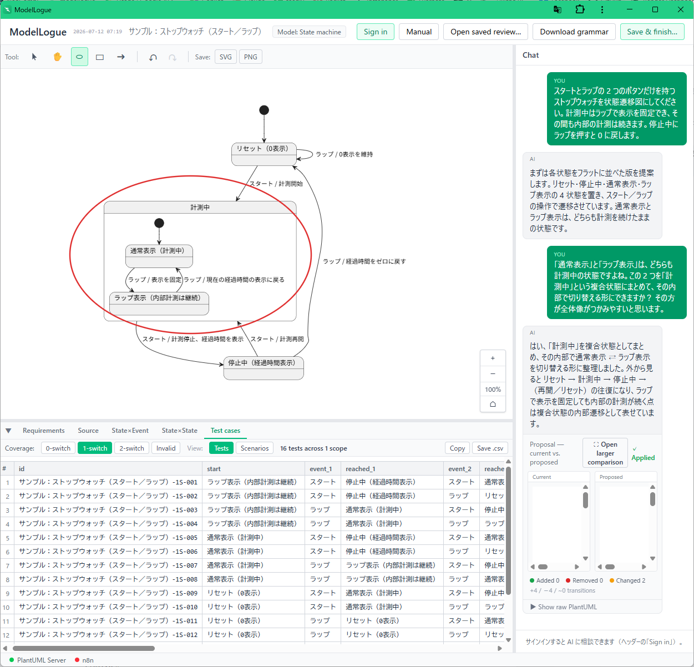

# ModelLogue

**ソフトウェア開発におけるモデルレビューを支援するプラットフォーム。**
モデル図を「一時的な思考のキャンバス（Volatile Canvas）」と位置づけ、人間とAIの
**対話ログ**を設計の本質的な資産として扱います。

🌐 デモ（限定公開ベータ）: **https://modellogue.com** — AIチャット以外は誰でも試せます。

> A platform for reviewing software-design models. It treats the diagram as a
> disposable "volatile canvas" and the human–AI **review dialogue** as the real
> design asset.



<sub>左に図（マーカー描画可）、下に状態遷移マトリクスと N-switch テストケース、右に AI との設計レビュー対話。図は使い捨て、対話ログが資産。</sub>

---

## コンセプト

図そのものは思考の途中経過（＝使い捨て可能）であり、レビューで交わされた**対話**こそが
設計判断の根拠として残すべき資産である、という考え方に基づいています。

いずれのモデル型も **「テキスト → 正規モデル → 図＋表」** という同じパターンを踏襲し、
同一のレビュー UX（ソース表示・AI対話・マーカー・提案の Apply/Undo・Save & finish）で扱えます。
意味解析と表生成は**フロントエンドのパーサー＋アルゴリズム**で完結し、LLM を必要としません。

## サポートするモデル型

| モデル型 | 入力 DSL | 生成物 |
|---|---|---|
| **状態遷移図** | PlantUML サブセット | PlantUML SVG（マーカーオーバーレイ付き）＋状態遷移マトリクス＋N-switch テストケース |
| **要求図** | SysML 風 DSL（`!procedure` マクロ呼び出し） | PlantUML SVG ＋トレーサビリティマトリクス＋孤立要求リスト |
| **プロセス図** | PlantUML activity サブセット | PlantUML SVG ＋レーン／イベント／分岐の可視化 |

モデル型はセッションごとに固定され、`src/modelTypes/<type>/` 配下の追加で 4 型目以降も導入できる構造です
（[ADR-012](Doc/adr/ADR-012-model-type-plugin-architecture.yaml)）。

## ⌨️ CLI: N-switch テストケース生成（GUI 不要）

状態遷移図から **N-switch カバレッジのテストケース**を生成する部分は、GUI と独立した
**スタンドアロンの Python CLI**（[tools/nswitch/](tools/nswitch/)）としても使えます。
PlantUML ソースまたは状態遷移表 CSV を入力に、テストケース CSV を標準出力へ吐きます。

```bash
pip install ./tools/nswitch

# 状態遷移図 → 1-switch テストケース CSV
modellogue-nswitch machine.puml -n 1

# 2-switch ＋ 無効遷移の負のテストも
modellogue-nswitch machine.puml -n 2 --invalid -o tests.csv

# シナリオ形式で、スコープ名を付けて
modellogue-nswitch machine.puml --scenarios --name Stopwatch

# HTTP API として常駐（GUI や CI から呼ぶ。docker compose でも起動）
modellogue-nswitch serve --port 8090
```

`-n` は 0 / 1 / 2（既定 1）。入力形式（`puml` / `csv`）は自動判別、`--format` で明示も可能。
インストールせずに動かす場合は `cd tools/nswitch && PYTHONPATH=src python -m modellogue_nswitch ...`。
契約の詳細は [tools/nswitch/Requirements_Specification.md](tools/nswitch/Requirements_Specification.md)（ADR-010）。

## アーキテクチャ

- **フロントエンド（SPA）は秘密情報を一切持たない。** APIキーは n8n 側で管理します。
- AI対話の中継は **n8n** が担い、意味解析・表生成は SPA 内で完結します。

| レイヤー | 技術 |
|---|---|
| フロントエンド | React + TypeScript（strict）+ Zustand + Tailwind CSS |
| ソースエディタ | CodeMirror |
| 図の表示 | ネイティブSVG（PlantUML SVG ＋自前のSVGマーカーオーバーレイ） |
| 図の生成 | PlantUML Server（Docker） |
| AI対話中継 | n8n（Docker） |

詳細は [Doc/architecture.md](Doc/architecture.md) と
[Doc/requirements/Requirements_Specification.md](Doc/requirements/Requirements_Specification.md) を参照してください。

## ローカルで動かす

前提: Docker / Docker Compose、Node.js。

```bash
# 1. バックエンド（PlantUML Server + n8n + N-switch API）を起動
docker compose up -d

# 2. フロントエンド
npm install
cp .env.example .env.local   # 必要に応じて編集
npm run dev
```

Vite の開発サーバが `/plantuml` `/n8n` `/nswitch` を各 Docker サービスへプロキシします
（[vite.config.ts](vite.config.ts)）。図の表示まではこれだけで動きます。

**AIチャット**を動かすには、n8n（http://localhost:5678）に
[n8n/workflows/](n8n/workflows/) のワークフローを取り込み、LLM の Credential を設定してください。
ローカルで AI ゲートを通す場合は `.env.local` に `AUTHGATE_ALLOW_INSECURE=1` が必要です
（本番では必ず `0`）。セットアップ手順は [Doc/setup_guide.md](Doc/setup_guide.md) を参照。

### よく使うスクリプト

```bash
npm run dev        # 開発サーバ
npm run build      # 型チェック＋本番ビルド
npm test           # ユニットテスト（Vitest）
npm run test:e2e   # E2E（Playwright）
npm run lint       # ESLint
```

## ディレクトリ構成

```
src/
├── components/     React コンポーネント（モデル型非依存）
├── modelTypes/     モデル型プラグイン（state-machine / requirement / process）
├── engines/        モデル型非依存の純粋アルゴリズム（SVG座標抽出など）
├── services/       外部サービス連携（PlantUML, n8n, nswitch, marker）
├── stores/         Zustand ストア
└── grammars/       各モデル型サブセットの EBNF 定義
tools/nswitch/      N-switch カバレッジテスト生成器（Python CLI + HTTP API）
Doc/                要求仕様・アーキテクチャ・ADR・セキュリティ設計
```

## ドキュメント

- [要求仕様書](Doc/requirements/Requirements_Specification.md)
- [アーキテクチャ設計書](Doc/architecture.md)
- [セキュリティ設計書](Doc/Security_Design.md)
- [ADR 一覧](Doc/ADR_Index.md)
- [トレーサビリティ](Doc/Traceability.md)

## ライセンス

[MIT License](LICENSE) © 2026 sho1884
